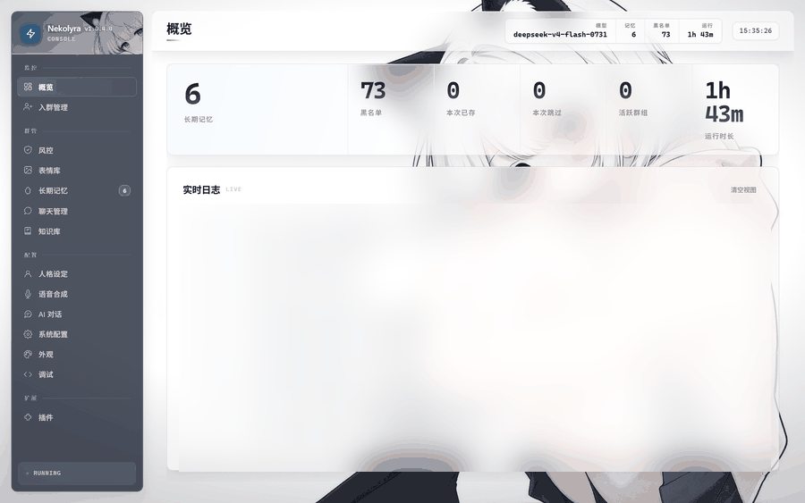
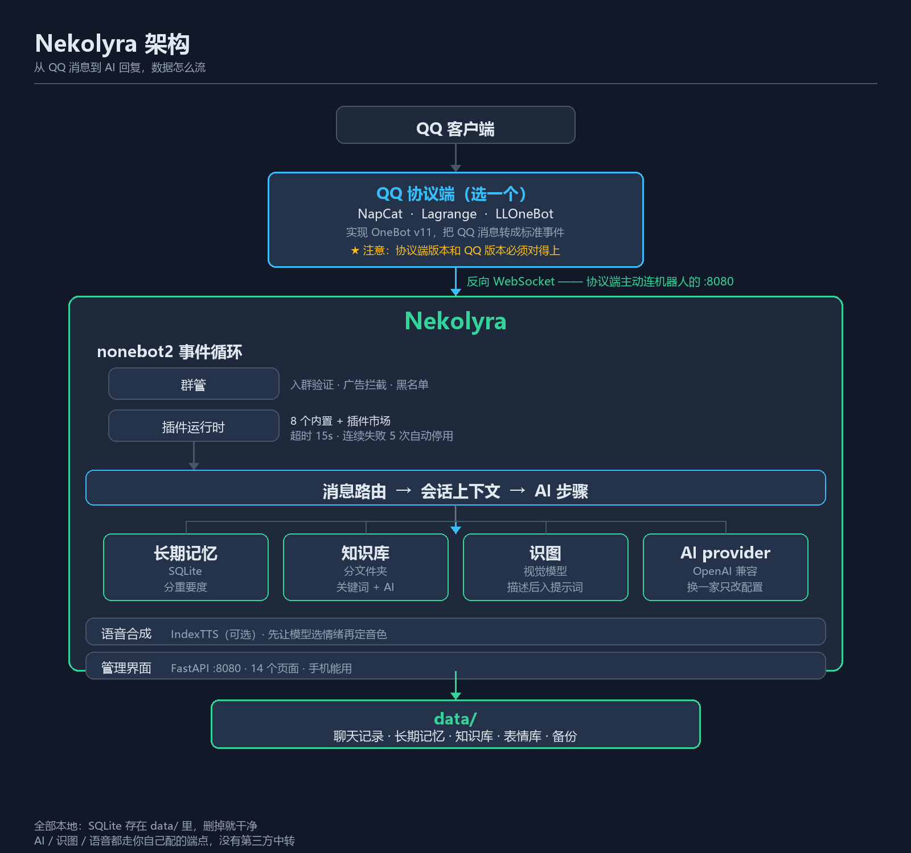

<div align="center">

# Nekolyra

**自己电脑上跑的 QQ 群 AI 机器人** —— 带数据库、长期记忆、知识库、插件运行时和一个完整的 Web 管理界面。

[](docs/screenshots/01-概览.png)


简体中文 · English（暂无）

<sub>当前版本 <b>1.0.4.4</b>（读 <code>VERSION</code> 文件）· <a href="#三分钟快速开始">三分钟快速开始</a> · <a href="CHANGELOG.md">更新日志</a></sub>

</div>

---

## 三分钟快速开始

```bash
# Windows：下载 Nekolyra-desktop-v*.zip → 解压到空目录 → 双击 Nekolyra.exe
# Linux ：git clone https://github.com/awnpw/Nekolyra.git && cd Nekolyra && pip install -r requirements.txt && python bot.py
# Docker：docker compose up -d          （⚠ 未实测，见下文）
```

跑起来是三件事，不是一件：

| 步骤 | 做什么 | 大概花多久 |
|---|---|---|
| **1** | 装一种跑法（[Windows](#windows) / [Linux](#linux) / [Docker](#docker)） | 1 分钟 |
| **2** | 配一个 **QQ 协议端** —— 机器人自己连不上 QQ，必须有它 | 3 分钟 |
| **3** | 填 **AI 接口** —— 不填它就不说话（别的功能照常） | 1 分钟 |

> **语音（TTS）是可选的**，不配也能用，只是不发语音。想开看[语音怎么配](#语音怎么配)。

**最容易踩的坑在协议端**：NapCat 的版本和 QQ 的版本必须对得上，错了不会报错，
只会静默失灵。见 [QQ 协议端怎么选](#qq-协议端怎么选)。

---

## 目录

| | | |
|---|---|---|
| [三分钟快速开始](#三分钟快速开始) | [AI 接口详细说明](#ai-接口详细说明) | [目录结构](#目录结构) |
| [它是什么](#它是什么) | [语音详细说明](#语音详细说明) | [常见问题](#常见问题) |
| [功能](#功能) | [配置项](#配置项) | [项目状态（说实话）](#项目状态说实话) |
| [架构](#架构) | [插件系统](#插件系统) | [隐私](#隐私) |
| [快速开始](#快速开始) | [参与贡献](#参与贡献) | [许可](#许可) |

---

## 它是什么

一个跑在 QQ 群里的 AI 助手，装在你自己的机器上，数据全在本地 `data/` 里。

它比"接个 API 回话"的脚本多做了几件事：

| | |
|---|---|
| **有记性** | 分群记忆 + 分人记忆 + 客观画像，三层互不干扰 |
| **能查资料** | 带文件夹层级的知识库，命中后自动注入提示词 |
| **能管群** | 入群验证、广告拦截、黑名单、退群自动拉黑、入群申请审批 |
| **能装插件** | 自带 8 个插件；不想要就停用，想加就自己写 |
| **有管理界面** | 14 个内置页面，浏览器里点点就行，不用改配置文件 |
| **能自己更新** | 检查新版本 → 下载 → **Ed25519 验签** → 替换。签名不对直接中止 |

**它不做什么**：不做多租户、不做云托管、不搞账号体系、没有移动端 App
（管理界面是响应式网页，手机浏览器直接开）。

---

## 功能

### 🤖 AI 对话

- 只要求对方兼容 **OpenAI 协议**（`POST /v1/chat/completions`）。DeepSeek、智谱、
  通义、Kimi、硅基流动、OpenRouter、one-api 网关、vLLM、LM Studio、Ollama 兼容层
  都是同一套配置
- **流式输出**，并记录首字延迟与总耗时
- **人格可写** —— 分「名字 / 身份 / 行为 / 说话风格」四段，支持全局 + 按群/按私聊覆盖
- **用户画像注入** —— 发言次数、活跃天数、积分这些**客观统计**会喂给模型，
  「我是谁」「我常来吗」才答得上
- **拆分回复** —— 长回复按长度和标点拆成多条发（`split_max_parts` 默认 3 段）
- **思考强度可调** —— `reasoning_effort`；推理模型返回的思维链会记进日志的
  「AI思维链」频道（截前 200 字），**不在群里展示**
- 私聊也支持，可用 `enable_private_chat` 关掉

### 🧠 长期记忆

三层，存在同一张 `memory` 表里，靠 `scope` 区分：

| 层 | 是什么 | 谁写的 |
|---|---|---|
| **群记忆** | 这个群发生过什么、定了什么规矩 | 后台异步分析 |
| **用户记忆** | 这个人说过什么、什么脾气，按 `(群, 用户)` 隔离 | 后台异步分析 |
| **用户画像** | 发言次数、活跃天数、积分、签到连续天数 | **直接查库**，不是模型总结的，不会瞎编 |

每 `memory_check_every` 轮（默认 4）触发一次分析，按重要度（`memory_min_importance`，默认 3）
和相关性注入。私聊时群号固定为 `0`，跟群记忆天然隔开。


### 📚 知识库

- **两级文件夹**（`kb` + `kb_folders` 两张表），比如 游戏 → 角色图鉴 / 主线剧情 / 卡池
- **批量导入**，支持 `问题|答案` 每行一条的纯文本，也支持 JSON；导出同理
- **自动分类**，导入时按关键词猜分类，还能事后「重新分类」
- **命中计数**，检索按分数排序并累加命中数（`kb_match_threshold` 默认 0.5）
- **按群隔离**，每群最多 `kb_max_per_group` 条（默认 500，防刷）
- **不写库的试跑** —— `POST /api/chat` 带 `dry_run`，回复是真的，但一个字节都不写
  （不动记忆、不写聊天记录、连命中计数都不加）。管理页的「AI 对话」页默认用它


### 🎭 表情库与识图

- 群里收到的图片/表情自动入库，**按内容 MD5 命名** —— 同一张图发一百次只占一份
- 可选让**视觉模型自动写备注**（`sticker_auto_note`），机器人能在合适的时候发出去
- 有数量（2000）、单张大小（2 MB）、总量（500 MB）、闲置天数（90 天）四道闸
- **识图**（`vision_enabled`，**默认关闭**）：先用视觉模型把图描述成文字，再进提示词


### 🛡️ 群管与风控

- **入群验证** —— 新人进群出一道算术题，`verify_timeout` 秒（默认 60）没答对就踢。
  另有 `min_qq_level`（默认 25）卡 QQ 等级
- **退群/被移出自动拉黑**（`bl_add`），申请入群时直接拒
- **黑名单按「群 + 人」记录**，管理页能看到全部条目；没有单独的"全局黑名单"
- **入群申请审批** —— 管理页「入群管理」里通过/拒绝，可写拒绝理由
- **超管命令** —— 踢、拉黑
- **广告拦截是插件**（`adfilter`），不是内置功能：硬关键词 + 软关键词 + 黑域名 + 白名单，
  命中后撤回 + 拉黑 + 踢出，并私聊通知超管

### 🔊 语音合成

- 接 **IndexTTS**（本地部署），走 OpenAI 兼容的 `POST /v1/audio/speech`
- **触发方式**：命中 `voice_trigger_keywords`（默认「语音/说话/念出来/读出来/讲给我听/voice」），
  或者按 `voice_random_chance` 概率随机发
- **情绪控制**：`vector` 模式走 8 维情感向量
  （喜、怒、哀、惧、厌恶、低落、惊喜、平静），比 `speaker` 模式断句自然
- **音频后处理**：`off / voice_clarity / clear_narration / deharsh / warm / normalize`，
  默认 `deharsh`
- **自动降级**：TTS 连不上就只发文字，不会卡住对话
- 音色名从服务端拉（`/v1/audio/voices`），不是写死的


### 🔌 插件

主程序**不内置**游戏类、娱乐类功能，全在插件里。仓库自带 8 个：

| 插件 | 显示名 | 做什么 | 注册了什么 |
|---|---|---|---|
| `gamefiles` | 游戏库 | 扫群文件建索引、用 AI 整理名称，群员问就回文件 + 链接 | 3 命令 · 2 钩子 · 5 接口 · 1 页 |
| `adfilter` | 广告拦截 | 关键词/黑域名命中就撤回、拉黑、踢出，私聊通知超管 | 1 钩子 · 3 接口 · 1 页 |
| `autoreply` | 关键词回复 | 关键词自动回复，带命中统计 | 1 钩子 · 3 接口 · 1 页 |
| `sign` | 签到积分 | 每日签到、积分、排行榜 | 7 命令 · 5 接口 · 1 页 |
| `lottery` | 抽奖 | 从最近活跃的群成员里随机抽一个 | 1 命令 · 1 接口 · 1 页 |
| `report` | 群报 | 统计群里某天的发言排行 | 3 命令 · 1 接口 · 1 页 |
| `wife` | 今日老婆 | 每天抽一个，带 AI 写的介绍和配图，可用积分换 | 2 命令 · 2 接口 · 1 页 |
| `hello` | 打招呼 | 最小示例，照着它学写插件最快 | 2 命令 |

**游戏库（`gamefiles`）单独说一下**，因为它是这套插件系统能做什么的最好例子：

- 扫指定文件夹（`gf_scan_folders`）下的群文件，建一份每群独立的索引
- `gf_ai_enabled` 时用 AI 把乱名字整理成游戏名 + 别名
  （`塞尔达传说 王国之泪 v1.2 汉化硬盘版.rar` → `塞尔达传说：王国之泪`），
  每轮扫描最多调 `gf_ai_max_calls`（默认 6）次、每次 `gf_ai_batch`（默认 30）条
- 群员**不用命令**，直接说「有没有 塞尔达」就回文件名 + 大小 + 下载链接
  （`gf_reply_limit` 默认回 5 条；`gf_send_mode` 可以改成直接发文件本体）
- 群里出现的**「QQ文件闪传」链接也会自动收**（`gf_collect_shares`）。
  这些链接**不在群文件列表里**，`get_group_root_files` 看不到，只能从消息里抓
- **每小时自动扫一次**（`gf_auto_scan_hours` 默认 1，下限 10 分钟），启动后先等 120 秒
- **带自己的管理页**（「游戏库」），可以看、筛、手动重扫、探测、遗忘

### 🖥️ 管理界面

单文件内嵌的 Web 界面（FastAPI + 原生 JS，**没有前端构建步骤**），
地址 `http://127.0.0.1:8080/admin?token=xxx`。

**14 个内置页面**，侧栏分四组：

| 分组 | 页面 |
|---|---|
| 监控 | 概览 · 入群管理 |
| 群管 | 风控 · 表情库 · 长期记忆 · 聊天管理 · 知识库 |
| 配置 | 人格设定 · 语音合成 · AI 对话 · 系统配置 · 外观 · 调试 |
| 扩展 | 插件（插件注册的页面也挂在这里，装齐自带插件再 +7 个） |

支持深色模式、响应式（手机能用）、壁纸自定义（内置预设 + 上传自己的图 + 压暗/模糊调节）。


### 其它

- **零配置启动** —— 第一次运行自动生成 `config.json`，并生成管理员 token 打印在控制台
- **配置热重载** —— 管理页改完立即生效，不用重启
- **单文件 SQLite** —— 没有外部数据库依赖
- **自动备份** —— 默认每天 3 点备份数据库到 `data/backup/`，留 7 天
- **定时清理** —— 聊天记录、表情、语音临时文件都有保留天数
- **日志双写** —— 控制台 + `startup.log`，带 trace id 和阶段耗时

---

## 架构



数据怎么走：

1. **QQ 客户端** —— 你平时用的那个
2. **QQ 协议端** —— NapCat / Lagrange.OneBot / LLOneBot 三选一，实现 OneBot v11，
   把 QQ 消息变成标准事件。它是**主动连过来**的一方（反向 WebSocket）
3. **Nekolyra** —— nonebot2 事件循环 → 群管 → 插件运行时 → 消息路由 → 会话上下文 → AI
4. **四路并行** —— 长期记忆（SQLite，按 `scope` 分层）、知识库（分文件夹，关键词检索）、
   表情库/识图（视觉模型）、AI provider（OpenAI 兼容协议，换一家只改配置）
5. **语音合成** —— IndexTTS，可选；先判断情绪，再按情绪挑音色
6. **管理界面** —— FastAPI，跟 OneBot 接口**共用同一个端口**
7. **data/** —— 聊天记录、记忆、知识库、表情、备份，全是本地 SQLite

**关于端口**：管理界面和 OneBot 反向 WebSocket 都在 `PORT`（默认 `8080`）上，
不需要第二个端口。OneBot v11 的路径由 nonebot2 的适配器注册，是 `/onebot/v11/ws`。

> ⚠️ **协议端版本和 QQ 版本必须对得上**，这是最容易踩的坑。
> 详见[快速开始 → QQ 协议端怎么选](#qq-协议端怎么选)。

---

## 快速开始

三种跑法**选一种**，然后都要再配 [QQ 协议端](#qq-协议端怎么选) 和 [AI 接口](#ai-接口怎么选)。

### Windows

去 [Releases](https://github.com/awnpw/Nekolyra/releases/latest) 下载
`Nekolyra-desktop-v*.zip`，**解压到一个空目录**（别解压到桌面或下载文件夹 ——
它会在这一层生成 `data/` 和 `config.json`），双击 `Nekolyra.exe`。

第一次启动会：

- 生成 `config.json`
- 生成管理员 token 并**打印在控制台**（进管理界面要用）
- 在 `8080` 起管理界面，并弹一个本地窗口（pywebview）
- 配置不完整时会先弹注册向导，而不是直接退出

**不想用桌面版**：照下面的 Linux 步骤走，Windows 上一样能跑。

### Linux

Python **3.12 及以上建议**。代码里没有硬性版本下限声明，`Dockerfile` 用的是 3.12，
开发机上跑的是 3.14，打包脚本遇到问题时的提示也是「换 Python 3.12 再试」。

```bash
git clone https://github.com/awnpw/Nekolyra.git
cd Nekolyra
pip install -r requirements.txt
python bot.py
```

管理界面那个桌面窗口需要图形环境。**服务器上没有桌面**就把 `pywebview` 省掉 ——
`import webview` 失败会降级成「不开窗口」，界面照常在 `8080` 提供：

```bash
pip install "nonebot2[fastapi]" nonebot-adapter-onebot httpx websockets Pillow
python bot.py     # 然后浏览器开 http://<服务器IP>:8080/admin
```

> 想让局域网里的手机也能开，把配置里的 `lan_access` 打开（监听 `0.0.0.0`）。
> ⚠ 开了等于把整个后台暴露给同网段的人，**务必先把 `admin_token` 换成强密码**。

### Docker

> ⚠ **这两个文件没有实测过** —— 作者机器上没装 Docker。
> 按设计应该能跑（`pywebview` 不装，容器里本来也没有 GUI），
> 但**未经验证**。要是有问题，请开 issue 附上 `docker build` 的完整输出。

```bash
docker compose up -d
docker compose logs -f nekolyra     # 第一次启动会打印管理员 token
```

然后浏览器开 `http://127.0.0.1:8080/admin`。

| | |
|---|---|
| 数据在哪 | `./data/`（挂载出来的，删容器不丢） |
| 配置在哪 | `./config.json`（第一次启动自动生成，也挂载了） |
| 改端口 | 改 `docker-compose.yml` 里 `8080:8080` 左边那个 |
| 为什么镜像里没有窗口 | 容器没有 GUI；`Dockerfile` 故意不装 `pywebview`，省掉 GTK 那一堆依赖 |
| 跑在哪个用户下 | 非 root（uid 10001），避免把挂载目录搞成 root 属主 |
| 镜像里有什么 | `bot.py`、`nekolyra/`、`data/plugins/`、`VERSION`、`requirements.txt` |

> **只有一个端口。** `bot.py` 只监听 `8080`，管理界面和 OneBot 反向 WS
> 都在它上面：管理界面是 `http://<host>:8080/admin`，OneBot 是
> `ws://<host>:8080/onebot/v11/ws`。协议端是**主动连过来**的一方，
> 机器人这边不开正向 WS，所以没有第二个端口。
>
> （`docker-compose.yml` 早期版本把 `8081` 标成「OneBot 正向 WebSocket」，
> 那个映射没有用 —— 已经删掉了。）

### QQ 协议端怎么选

**机器人自己连不上 QQ。** 必须有个协议端把 QQ 消息转成 OneBot v11 事件。
三个主流的，**选一个**：

| | NapCat | Lagrange.OneBot | LLOneBot |
|---|---|---|---|
| 形态 | 独立程序 / QQ 插件 | 独立程序 | LiteLoaderQQNT 插件 |
| 上手 | 最容易，文档全 | 中等 | 要先装 LiteLoader |
| **推荐** | **首选** | 备选 | 已经在用 QQNT 插件的话 |

拿 **NapCat** 举例：

**1.** 下载 [NapCat](https://github.com/NapNeko/NapCatQQ) 并登录你的 QQ（**建议用小号**）

> ### ★ NapCat 的版本和 QQ 的版本必须对得上
>
> 这是整个部署里最容易踩、也最难查的坑，因为它**不报错**。
>
> **已知情况（2026-10 实测）**：**NapCat 4.18.30 + QQ 9.9.36** 会出问题 ——
> NapCat 的包层钩子认不出这个 QQ 版本，于是**所有走包层的动作全部失效**：
> 取群文件下载链接、撤回消息、踢人、精华消息……
>
> **症状有两个，都很不显眼**：
>
> - 取群文件链接返回 `null`，**不报错、不抛异常，静默给空**
> - NapCat 日志里写 `[Core] [Packet] PacketBackend 不支持当前QQ版本架构`
>
> **为什么会连累机器人**：`gamefiles` 插件靠 `ctx.onebot("get_group_file_url", …)`
> 拿下载链接。包层废了 → 动作返回空 → 插件只能回文件名回不了链接，
> 而**界面上看不出任何错误**。
>
> **解法**：升级 NapCat。**4.18.34 起支持 QQ 9.9.36**，用最新版最省事。
> 用 NapCatQQ Desktop 的话，「组件」页可以单独升级 NapCat 组件，不用动你自己的 QQ。
>
> 相关配置项在 NapCat 的 `config/napcat.json` 里，叫 `packetBackend`（默认 `"auto"`）。
>
> 另外 Desktop 会提示「Bot 和你平时用的 QQ 共用同一份程序」——
> **建议给 Bot 单独装一份 QQ**（组件页有入口），这样 QQ 自动更新也不会再把 Bot 搞坏。

**2.** 打开 NapCat 的 WebUI → 「网络配置」→ **新建 → WebSocket 客户端**

**3.** URL 填 `ws://127.0.0.1:8080/onebot/v11/ws`，保存并启用

> `8080` 就是机器人自己的端口 —— **管理页和 OneBot 接口在同一个端口上**。
> NapCat 是主动连过来的一方，机器人这边不需要另开端口。

**4.** 回到管理界面，「概览」页会显示**在线**

**连不上先看两处**：管理界面的实时日志里有没有 `✓ 连接 | 机器人 xxx 上线`；
协议端那边的连接状态是不是已启用。

### AI 接口怎么选

没配 AI 它**不会说话**（其他功能照常）。只要求对方兼容 **OpenAI 协议**。

在管理界面「系统配置 → AI 后端」填，或者直接改 `config.json`：

```json
{
  "ai_backend":     "openai",
  "openai_host":    "https://api.deepseek.com",
  "openai_api_key": "sk-...",
  "openai_model":   "deepseek-chat"
}
```

`openai_host` **写到域名，或者写到 `/v1` / `/v4` 为止** ——
代码判断结尾是不是 `/v1`、`/v4`、`/v3`、`/v2`、`/api`，不是就自动补 `/v1`。

| 你想用什么 | 怎么填 |
|---|---|
| **DeepSeek 官方** | `ai_backend: "openai"` · host `https://api.deepseek.com` · model `deepseek-chat` |
| **智谱 GLM** | host `https://open.bigmodel.cn/api/paas/v4`（结尾是 `/v4`，不会被再补 `/v1`） |
| **自建网关 / 中转** | `ai_backend: "openai"` + 你的地址（one-api、OpenRouter 等都行） |
| **本地 Ollama** | `ai_backend: "ollama"` · `ollama_host: "http://localhost:11434"` · `ai_model: "qwen3:4b"` |

**老配置不用改**：`ai_backend` 填 `deepseek` 或 `ollama` 也认 ——
它们在代码里被映射到同一个 OpenAI provider，只是读 `deepseek_*` / `ollama_*` 那几组键。

> 这三个键（`openai_host` / `openai_model` / `openai_api_key`）只在
> `ai_backend` 填 `openai` 时用；填 `deepseek` / `ollama` 时管理页会把它们藏起来。

**填完点保存**，管理界面会立刻重载，日志里出现这样一行就是通了
（方括号里是实际选中的后端名）：

    ✓ [AI] deepseek 连接正常（glm-4.7-flash）

默认配置（`ai_backend=deepseek`）下就长这样；填 `openai` 时方括号里会变成 `openai`。

### 语音怎么配

**可选。不配也能用，只是不发语音。**

语音走 [IndexTTS](https://github.com/index-tts/index-tts)（本地跑，不花钱）。
装好并让它在 `7861` 上提供 OpenAI 兼容的 `/v1/audio/speech` 之后：

```json
{
  "voice_enabled": true,
  "voice_api_url": "http://127.0.0.1:7861/v1/audio/speech",
  "voice_name":    "你在 IndexTTS 里保存的音色名",
  "voice_trigger_keywords": ["语音", "说话", "念出来"]
}
```

管理界面「语音合成」页有测试按钮，能直接试听。启动时也会探测一次，
日志里出现 `✓ [语音] IndexTTS 连接正常（测试音频 xxKB）` 就对了。

> **键名是 `voice_api_url`，不是 `voice_host`** —— 早期文档里写错过，以本文档为准。

装 IndexTTS、下模型、调音色的完整步骤见[语音详细说明](#语音详细说明)。

### 打包自己的 exe

```bash
pip install pyinstaller
python build.py            # 或者 pyinstaller Nekolyra.spec
python _build_guard.py     # 35 项发布前探测，全过才让发
```

---

## AI 接口详细说明

程序只要求对方兼容 **OpenAI 协议**：`POST {base}/v1/chat/completions`、
`Authorization: Bearer <key>`、SSE 流式取 `choices[0].delta.content`。

### 三种 `ai_backend`

| 值 | 用哪组键 | 说明 |
|---|---|---|
| `openai` | `openai_host` / `openai_model` / `openai_api_key` | 推荐。任何 OpenAI 兼容端点 |
| `deepseek` | `deepseek_api_host` / `deepseek_model` / `deepseek_api_key` | 老写法，映射到同一个 provider |
| `ollama` | `ollama_host` / `ai_model` / `ollama_api_key` | 老写法，同上；key 留空会默认填 `ollama` |

字段名保留 `deepseek_` 前缀只是历史原因，**不绑定任何厂商**。
（默认值里 `deepseek_api_host` 指向的其实是智谱：`https://open.bigmodel.cn/api/paas/v4`。）

写错的 `ai_backend` 不会偷偷回退 —— 日志里会写
`不认识的 ai_backend=...，AI 将不可用`，界面显示未启用。

### 首字延迟 vs 总时长

这两个是**两回事**：首字慢是排队/线路问题，总时长慢是生成速度问题。
每次调用都会记一行（`nekolyra/adapters/ai.py`）：

```
[10-14 19:23:01] · [AI] deepseek 首字 1.7s | 总 1.7s | 29 字
```

推理模型的思维链另外记一条，截前 200 字：

```
[10-14 19:23:01] · [AI思维链] 用户问的是……
```

想知道**卡在哪一段**，看阶段打点（这些是机器人自己的耗时，不含模型生成）：

```
[10-14 19:23:01] · [追踪] [a1b2c3d4] 插件 +8ms  总 12ms
[10-14 19:23:01] · [追踪] [a1b2c3d4] 进 AI +12ms  总 24ms
[10-14 19:23:02] · [追踪] [a1b2c3d4] AI 回来，29 字 +1712ms  总 1736ms
```

### 作者自己的实测记录

> 下表是作者在同一台机器、同一句话上量出来的，**属于经验记录，不是代码里的东西**，
> 也没有在本次文档重写中复测。只当参考。

| 模型 | 首字 | 备注 |
|---|---|---|
| `kimi-k2.6` | 0.3s | 最快 |
| `qwen3.8-27b` | 0.5s | |
| `deepseek-v4-flash-0731` | 0.9s | 快，回复质量稳 |
| `deepseek-v4-pro-0813` | 11.8s | 慢一个量级 |
| `intern-s2` | 1.4s / 16.9s | 波动很大 |
| `minimax-m3` | 0.5s | ⚠ 会把 `<mm:think>` 思维链一起吐进正文 |

### 其它相关配置

| 键 | 默认 | 作用 |
|---|---|---|
| `ai_enabled` | `true` | AI 总开关（**只能改 config.json**） |
| `reasoning_effort` | `"none"` | 思考强度；`none`/`off` 最省时间，`low/medium/high` 让它多想 |
| `plan_model` | `""` | 内部调用（记忆分析、情绪打标）专用的模型；留空就跟着对话模型走 |
| `ai_context_size` | `4` | 短期上下文轮数 |
| `ai_min_gap` / `ai_max_gap` | `2.0` / `5.0` | 回复前随机等待的上下界，`0` = 不等 |
| `ai_model` | `"qwen3:4b"` | **Ollama 专用**的模型名 |

**推理模型的重试**：只重试「一个字都没收到」的情况。已经收到内容的不重试 ——
否则会把同一段话说两遍、或者发出两截。

---

## 语音详细说明

1. 本地部署一个 **IndexTTS** 服务，让它提供 OpenAI 兼容接口
2. 配置里开 `voice_enabled`，填 `voice_api_url`
3. 在 IndexTTS 里给参考音频起好音色名（音色列表由程序从 `/v1/audio/voices` 拉取；
   `voice_api_url` 结尾是 `/speech` 时会自动换成 `/voices`）
4. 管理页「语音合成」页里配**情绪 → 音色**映射（`voice_emotion_voices`）

| 键 | 默认 | 作用 |
|---|---|---|
| `voice_enabled` | `false` | 总开关 |
| `voice_api_url` | `http://127.0.0.1:7861/v1/audio/speech` | 服务地址 |
| `voice_api_key` | `""` | 需要鉴权才填 |
| `voice_name` | `""` | 默认音色名 |
| `voice_speed` | `1.0` | 语速 |
| `voice_timeout` | `90` | 单次生成超时（秒） |
| `voice_max_chars` | `200` | 超过就不发语音，转文字 |
| `voice_random_chance` | `0.0` | 没命中关键词时随机发语音的概率 |
| `voice_trigger_keywords` | 6 个词 | 命中就发语音 |
| `voice_emotion_mode` | `"vector"` | `vector` 断句更自然；也可用 `speaker` |
| `voice_emotion_vector` | `[0.1,0,0,0,0,0,0,0.4]` | 8 维：喜、怒、哀、惧、厌恶、低落、惊喜、平静 |
| `voice_emotion_strength` | `0.65` | 情感强度 |
| `voice_postprocess_preset` | `"deharsh"` | `off / voice_clarity / clear_narration / deharsh / warm / normalize` |
| `voice_postprocess_strength` | `1.0` | 后处理强度 |

**没配也能用** —— 连不上会自动降级成纯文字，并把失败记进日志，不会卡住对话。
生成的临时文件放在 `data/voice_tmp/`，超过 1 小时的会被定时清掉。

---

## 配置项

配置在程序目录下的 `config.json`，第一次启动自动生成，**共 108 个默认键**。
大部分能在管理页里改（改完热重载）。

**只能改文件、管理页改不了的四个键**：

| 键 | 默认 | 为什么 |
|---|---|---|
| `superusers` | `[]` | 超管 QQ 列表，接口刻意不给改 |
| `port` | `8080` | 改端口要重启，热重载没意义 |
| `ai_enabled` | `true` | 不在白名单里 |
| `notify_admin_on_request` | `true` | 不在白名单里 |

<details>
<summary><b>AI / 记忆 / 知识库</b></summary>

| 键 | 默认 | 说明 |
|---|---|---|
| `ai_backend` | `"deepseek"` | `openai` / `deepseek` / `ollama` |
| `openai_host` `openai_model` `openai_api_key` | `""` | `openai` 后端用 |
| `deepseek_api_host` | 智谱 v4 地址 | `deepseek` 后端用 |
| `deepseek_model` | `"glm-4.7-flash"` | |
| `deepseek_api_key` | `""` | |
| `ollama_host` | `http://localhost:11434` | |
| `ai_model` | `"qwen3:4b"` | |
| `ollama_api_key` | `"ollama"` | |
| `ai_context_size` | `4` | 短期上下文轮数 |
| `memory_check_every` | `4` | 每几轮触发一次记忆分析 |
| `memory_min_importance` | `3` | 低于这个重要度不注入 |
| `memory_inject_count` | `1` | 群记忆注入条数 |
| `memory_user_enabled` | `true` | 用户记忆开关 |
| `memory_user_inject_count` | `3` | 用户记忆注入条数 |
| `kb_enabled` | `true` | 知识库总开关 |
| `kb_auto_inject` | `true` | 对话时自动注入命中条目 |
| `kb_match_threshold` | `0.5` | 匹配分数阈值 |
| `kb_inject_count` | `3` | 最多注入几条 |
| `kb_answer_max_chars` | `500` | 单条回答最大长度 |
| `kb_max_per_group` | `500` | 每群条数上限 |
| `kb_add_keywords` / `kb_del_keywords` / `kb_list_keywords` / `kb_search_keywords` | 见默认值 | 群里的自然语言触发词 |

</details>

<details>
<summary><b>回复行为 / 人格</b></summary>

| 键 | 默认 | 说明 |
|---|---|---|
| `talk_value` | `0.0` | 触发回复的概率，`0` = 每条都回 |
| `reply_to_name` | `true` | 回复时带上对方昵称 |
| `ai_min_gap` / `ai_max_gap` | `2.0` / `5.0` | 回复前随机等待秒数，`0` = 不等 |
| `split_reply` | `true` | 拆分回复 |
| `split_max_length` | `100` | 每段最大长度 |
| `split_max_parts` | `3` | 最多拆几段 |
| `split_delay_seconds` | `0.8` | 段与段之间的间隔 |
| `enable_private_chat` | `true` | 私聊对话开关 |
| `persona_name` / `persona_identity` / `persona_behavior` / `persona_speech` | `""` | 人格四段 |
| `persona_overrides` | `{}` | 按会话覆盖人格，键是 `"g:<群号>"` / `"u:<QQ号>"`，**只填想改的项** |
| `reasoning_effort` | `"none"` | 思考强度 |
| `plan_model` | `""` | 内部调用模型 |

</details>

<details>
<summary><b>群管 / 验证 / 日志</b></summary>

| 键 | 默认 | 说明 |
|---|---|---|
| `verify_enabled` | `true` | 入群验证开关 |
| `verify_timeout` | `60` | 答题超时秒数，超时踢 |
| `min_qq_level` | `25` | 低于这个 QQ 等级直接拒 |
| `welcome_msg` | `"欢迎 {nickname} 加入本群！"` | 支持 `{nickname}` `{user_id}` `{group_id}` |
| `farewell_msg` | `"{nickname} 离开了群聊。"` | |
| `reject_msg` | `"你已在黑名单中…"` | 拒绝入群时给对方看的话 |
| `notify_admin_on_request` | `true` | 有入群申请时通知超管（**只能改文件**） |
| `log_all_group_msgs` | `true` | **每条**群消息都进聊天记录，不只是机器人回过的 |
| `chatlog_enabled` | `true` | 聊天记录开关 |
| `chatlog_keep_days` | `30` | 保留天数 |
| `chat_log_keep_days` | `30` | 清理线程用的保留天数 |
| `backup_enabled` | `true` | 自动备份 |
| `backup_hour` | `3` | 每天几点备份 |
| `backup_keep_days` | `7` | 备份保留天数 |
| `github_token` | `""` | 可选。检查更新用，未登录是 60 次/小时 |

</details>

<details>
<summary><b>语音 / 识图 / 表情 / 外观</b></summary>

语音相关见[语音详细说明](#语音详细说明)的表格。

| 键 | 默认 | 说明 |
|---|---|---|
| `vision_enabled` | `false` | 识图开关（默认**关**） |
| `vision_api_host` | 智谱 v4 地址 | |
| `vision_api_key` | `""` | |
| `vision_model` | `"glm-4v-flash"` | |
| `vision_timeout` | `90` | |
| `vision_max_image_kb` | `4096` | 超过就不送 |
| `sticker_enabled` | `true` | 表情库 |
| `sticker_auto_note` | `true` | 用视觉模型自动写备注 |
| `sticker_send_enabled` | `true` | 允许机器人主动发表情 |
| `sticker_max_kb` | `2048` | 单张上限 |
| `sticker_max_count` | `2000` | 数量上限（超了淘汰最久没用的） |
| `sticker_max_mb` | `500` | 总大小上限 |
| `sticker_keep_days` | `90` | 闲置清理天数 |
| `sticker_auto_chance` | `0.25` | 情绪匹配时主动发的概率 |
| `wallpaper_enabled` | `true` | 壁纸总开关 |
| `wallpaper_preset` | `"kv"` | `kv` / `aurora` / `frost` / `rose` / `gold` / `ink` / `custom` |
| `wallpaper_dim` | `40` | 压暗 0–88 |
| `wallpaper_blur` | `0` | 模糊 0–40 px |
| `wallpaper_rotate` | `false` | 自动轮播 |
| `wallpaper_rotate_sec` | `15` | 轮播间隔 |
| `ui_side_*` / `ui_face_*` | 见默认值 | 侧栏和内容面的毛玻璃/透明度/底色，含深色模式专用色 |
| `lan_access` | `false` | 允许局域网访问管理界面 |
| `admin_token` | `"change-me-please"` | **一定要改** |

</details>


---

## 插件系统

插件放在 `data/plugins/<插件名>/`，管理页「插件」页能看到列表、启停、配置、重新加载。

### 装插件

三种方式：

1. **从市场装** —— 管理页「插件」页的市场上点一下
2. **直接给一个 GitHub 仓库地址装** —— 不用等收录
3. **手动丢目录** —— 把插件目录放进 `data/plugins/`，点「重新加载插件」

市场注册表是一份 `index.json`（默认在
[`Nekolyra-plugins`](https://github.com/awnpw/Nekolyra-plugins) 仓库根目录）：

```json
{
  "version": 1,
  "plugins": [
    {
      "name": "hello",
      "display_name": "打招呼",
      "version": "1.0.0",
      "author": "someone",
      "description": "示例插件",
      "repo": "https://github.com/user/nekoe-plugin-hello",
      "tags": ["示例"]
    }
  ]
}
```

**安装时的防护**：下载包上限 30 MB、解压后总大小上限 120 MB、文件数上限 3000、
解压拒绝越界路径。插件目录名受白名单约束 `^[\w.\-]{1,48}$`，
**另外单独拒绝纯点名**（`.` / `..`）—— 因为那个正则里的 `.` 是字面量，
早期版本会让 `..` 通过，而 `data/plugins/..` 正好指向 `data/`。

> ⚠ **插件终究是要在你机器上跑的 Python 代码**，权限声明只是给人看的、不是沙箱。装之前自己想清楚。


### 自己写插件

一个插件就是两个文件：

| 文件 | 作用 |
|---|---|
| `metadata.json` | 元信息：名字、版本、默认配置、配置表单 schema、权限声明 |
| `main.py` | 入口，里面定义 `def setup(ctx)` |

**不要（也不能）import 宿主的内部模块。** 加载器会在执行插件代码**之前**扫一遍源码，
命中下面这些就拒绝加载，并在插件卡片上写明原因：

```
import bot
from bot import
import nekolyra.core
from nekolyra.core
import nekolyra.storage
from nekolyra.storage
import nekolyra.web
from nekolyra.web
```

用意是给插件一个**稳定的边界**：主程序内部随便重构，只要 `ctx` 这套方法不变，插件就不会坏。

> 这是**字符串级的行首检查**，不是安全沙箱 —— 它挡的是「顺手 import 一下」这种无意的越界，
> 不是防恶意代码。注释行会跳过。
> 注意 `nekolyra.adapters.*` / `nekolyra.plugins.*` / `nekolyra.api` **不在**拦截名单里。

最小可跑的例子（`setup(ctx)` 的写法跟自带的 `hello` 插件一致）：

```python
# data/plugins/hello/main.py

def setup(ctx):
    """插件入口，加载时被调用一次。"""

    @ctx.command("你好", "被 @ 且内容正好是「你好」时触发")
    async def on_hello(event, cmd):
        await ctx.send_group(event.group_id, f"你好，{await ctx.nick(event.group_id, event.user_id)}！")
        return True          # True = 已处理，不再走内置逻辑

    @ctx.on_message()
    async def watch(event, text):
        if "广告" in text:
            await ctx.delete_msg(event)
            return True      # 吞掉这条
        return False         # 放行给主程序

    ctx.register_config("打招呼插件", [
        ["hello_reply",  "回复内容", "text"],
        ["hello_suffix", "附加后缀（留空不显示）", "text"],
    ])
```

改完在管理界面点「重新加载插件」即可生效，**不用重启**。

#### `ctx` 上有什么

这是**完整**的 API（`nekolyra/plugins/context.py`），逐个核对过：

| 分类 | 方法 |
|---|---|
| **日志** | `ctx.log(msg)` · `ctx.warn(msg)`（会带上插件名和 trace id） |
| **注册能力** | `ctx.command(cmd, help="", prefix=False, timeout=None)` · `ctx.on_message(timeout=None)` · `ctx.register_page(pid, title, html="")` · `ctx.register_api(path, handler, methods=("GET",), timeout=None)` |
| **配置** | `ctx.cfg(key, default=None)` · `ctx.set_cfg(key, value)` · `ctx.config`（属性，返回 dict） · `ctx.register_config(title, fields)` |
| **发消息** | `await ctx.send_group(gid, content)` · `await ctx.send_private(uid, content)` · `ctx.mention(uid)` · `ctx.image(url)` |
| **群管** | `await ctx.delete_msg(event)` · `await ctx.kick(gid, uid, reject_add=True)` · `ctx.bl_add(uid, gid, nick="", reason="")` · `ctx.is_super(uid)` · `await ctx.nick(gid, uid)` |
| **群信息** | `await ctx.group_name(gid)` · `ctx.self_id()` |
| **协议层** | `await ctx.onebot(action, **params)` |
| **数据库** | `ctx.db()`（返回 sqlite3 连接） · `ctx.db_exec(sql, params=())` · `ctx.db_query(sql, params=())` |
| **键值存储** | `ctx.kv_get(key, default=None)` · `ctx.kv_set(key, value)` |
| **AI / 网络** | `await ctx.ai(prompt, timeout=15.0, use_gap=False)` · `await ctx.http_get(url, params=None, timeout=15.0, headers=None)` |
| **积分 / 签到** | `ctx.sign_do(uid, gid, nick, base, bonus_per, bonus_cap, today)` · `ctx.sign_get(uid, gid)` · `ctx.sign_rank(gid, limit=10)` · `ctx.sign_rank_all()` · `ctx.sign_clear_group(gid)` · `ctx.points_spend(uid, gid, amount)` → `(ok, 剩余)` · `ctx.points_refund(uid, gid, amount)` |
| **统计** | `ctx.daily_rank(gid, date_str, limit=10)` · `ctx.daily_summary(gid, date_str)` · `ctx.act_recent(gid, days=7)` |
| **元信息** | `ctx.name` · `ctx.display_name` · `ctx.version` · `ctx.author` · `ctx.description` · `ctx.tags` · `ctx.dir` · `ctx.api_version` · `ctx.permissions` · `ctx.dependencies` · `ctx.info()` |

几个容易用错的细节：

- `ctx.mention(uid)` / `ctx.image(url)` 返回的是**片段**，要放进列表里一起传：
  `await ctx.send_group(gid, [ctx.mention(uid), " 恭喜中奖！", ctx.image(url)])`
- handler 的签名是**定死的**：命令是 `(event, cmd)`，消息钩子是 `(event, text)`，
  接口是 `(request, body)`。个数不对**注册时就报错**，不用等群里发命令
- 接口的 `request` 是 FastAPI 的 `Request`（查询参数用 `request.query_params.get("x")`），
  `body` 是 POST 的 JSON dict（GET 时是 `{}`）。返回的东西会被 JSON 序列化
- `ctx.register_page` 的 `html` 里可以直接写 `<script>`，会被执行 ——
  但脚本跑在**全局作用域**，函数名请自己加前缀，别用 `load()` / `run()` 这种通用名
- `ctx.register_config` 声明的配置**不会**混进「系统配置」页 ——
  它们出现在**这个插件自己的配置小窗**里（插件卡片上点「配置」）
- `ctx.onebot()` 返回动作的原始结果（通常 dict），**所有连接都失败时返回 `None`**。
  注意 `None` 和「动作成功但结果为空」是两回事，要分开处理
- `ctx.ai()` 失败返回**空字符串**（不抛异常）；`ctx.http_get()` 走主程序的共享客户端，
  本机地址会自动直连（系统代理开着也不会把 localhost 请求发给代理）
- `ctx.db()` 是主库连接，**插件自己的表自己建**，表名建议加插件名前缀

#### 三个必须知道的坑

**① `timeout` 一定要给做实事的 handler 填**

核心有一个**全局**的插件超时（配置里 `plugin_timeout`，**默认 15 秒**）。
超了就把这次调用当失败、**消息继续往下走** —— 表现是"命令没反应"，
而且消息会落到 AI 手里被**抢答**：

```
[10-14 19:23:01] ⚠ [插件] 游戏库 处理超时（超过 15s）—— 这次跳过它，消息继续往下走
[10-14 19:23:01] · [追踪] [a1b2c3d4] 进 AI +15003ms  总 15041ms
[10-14 19:23:03] · [AI] deepseek 首字 1.7s | 总 1.9s | 29 字
REPLY -> 扫游戏库？你是要我帮你看看都有什么游戏吗。   ← AI 抢答了
```

所以扫群文件、调 AI、拉外部 HTTP 这种要做几十秒的，**必须自己声明**：

```python
@ctx.command("扫游戏库", "重建索引", timeout=600)
@ctx.on_message(timeout=600)          # 发文件/传大文件可能很久
@ctx.register_api("/admin/api/plugins/x/scan", h, ("POST",), timeout=120)
```

自带的 `gamefiles` 就是这么做的：`扫游戏库` 给了 600 秒、`重扫游戏库` 900 秒、
问询钩子 600 秒、扫描接口 120 秒。**别的插件用全局默认值时，默认值只有 15 秒。**

> 超时只对**会让出事件循环**的代码有效（`await sleep` / 网络请求）。
> 插件里写同步死循环**打断不了** —— 那是 Python 的限制。

**② 处理完一定要 `return True`**

handler 返回 `None`（比如忘了写 `return`）时，程序**不会**认为"已处理" ——
消息会继续往下传，可能被内置逻辑或 AI 接走，**同一句话回两遍**。
日志里会警告一次：

```
[10-14 19:23:01] ⚠ [插件] 打招呼 的命令「你好」处理函数没有 return True/False（返回了 None）。
                消息会继续往下传，可能被内置逻辑或 AI 对话接走。处理完请 return True。
```

**③ `ctx.group_name()` 是 async 的**

不 await 会拿到一个协程对象，然后 `json.dumps` 报
`Object of type coroutine is not JSON serializable`。
`ctx.nick()` / `ctx.send_group()` / `ctx.delete_msg()` / `ctx.onebot()` / `ctx.ai()` /
`ctx.http_get()` 同样是 async。同步的是 `ctx.cfg` / `ctx.is_super` / `ctx.bl_add` /
`ctx.db_query` / `ctx.sign_rank` / `ctx.points_spend` 这些。

#### 加载器会拦什么

| 情况 | 结果 |
|---|---|
| `import bot` / `nekolyra.core` / `nekolyra.storage` / `nekolyra.web` | **拒绝加载**，卡片上写明原因 |
| `metadata.json` 缺 `name`、或 `name` 不合法 | **拒绝加载**（`name` 只能 `^[a-z0-9_][a-z0-9_.-]{0,63}$`） |
| `name` 跟已加载的插件重复 | 后一个被忽略（`name` 是唯一键，日志里说明被谁占了） |
| `api_version` 跟核心不兼容 | **拒绝加载**并说清楚 |
| `entry` 指向插件目录之外 | 忽略该字段，回退到 `main.py` |
| handler 参数个数不对 | **注册时当场报错**，不用等群里发命令 |
| 缺 `api_version` | 只警告，按 `1.0` 算（老插件不用改） |
| 声明了不认识的权限 | 只警告 |

**`metadata.json` 认识的字段**：

| 字段 | 必填 | 说明 |
|---|---|---|
| `name` | **是** | 插件标识，跟目录名一致 |
| `display_name` | | 管理页显示的名字 |
| `version` | | 插件自己的版本 |
| `author` / `description` / `tags` | | 展示用 |
| `entry` | | 入口文件，默认 `main.py` |
| `api_version` | | 要求的核心 API 版本，默认 `1.0` |
| `permissions` | | 声明式权限，见下 |
| `dependencies` | | 依赖的其它插件：`["名字"]` 或 `{"名字": "版本"}` |
| `config` | | 配置分组 `[{"title": ..., "fields": [[键, 标签, 类型], ...]}]` |
| `defaults` | | 配置默认值 |

**`api_version` 的兼容规则**：主版本必须相同，次版本不能超过核心。
第三段及以上忽略 —— 核心修个 bug 不该让插件跑不了。
当前核心是 `API_VERSION = "1.0"`。

**权限是声明给用户看的，不是强制拦截**（本机插件本来就能干这些事）：

| 权限 | 含义 |
|---|---|
| `db` | 读写数据库（只该动自己建的表） |
| `http` | 发 HTTP 请求（联网） |
| `fs` | 读写自己插件目录里的文件 |
| `ai` | 调用 AI |
| `send` | 主动发消息（不只是回复当前这条） |
| `config` | 读写插件自己的配置 |

配置项的**类型**：`bool` / `number` / `text` / `backend`（下拉）/ `model` 等，跟内置渲染器一致。

**插件崩了、死循环、超时不会拖垮主程序**：每次调用都有超时和异常捕获，
**超时 + 报错合计连续 5 次**就被自动停用，原因写在插件卡片上；
成功一次就把计数清零（只关心**连续**失败）。修好后在插件列表里重新启用。

---

## 目录结构

**跑起来之后**（桌面版 / 源码运行的目录）：

| 路径 | 是什么 |
|---|---|
| `Nekolyra.exe` | 主程序（打包版；源码运行就是 `bot.py`） |
| `VERSION` | 当前版本号，程序启动时读它 |
| `config.json` | 配置，首次运行生成 |
| `.env` | nonebot 驱动声明（`DRIVER=...`），Dockerfile 会写一份 |
| `startup.log` | 启动与运行日志（控制台输出的那份副本） |
| `data/bot.db` | **主库**：记忆、知识库、聊天记录、积分、表情、黑名单、活跃度 |
| `data/plugins/` | 插件目录 |
| `data/plugins.json` | 插件状态：启用/停用、私有键值存储 `kv` |
| `data/plugin_market.json` | 插件市场索引的本地缓存（断网也能看） |
| `data/stickers/` | 表情库文件，按内容 MD5 命名 |
| `data/backup/` | 数据库备份，`bot-YYYY-MM-DD.db` |
| `data/voice_tmp/` | 语音生成的临时文件（超 1 小时清理） |
| `data/updates/` | 更新包下载目录 |
| `data/wallpaper.*` | 你自己上传的壁纸（如果设了） |

> 老版本可能还留下 `data/blacklist.db` 和 `data/official_bot.db`（后者来自已经移除的
> 「QQ 官方机器人接口」）。它们**不是**当前程序在用的库，删掉不影响运行。

**源码这边**：

| 路径 | 是什么 |
|---|---|
| `bot.py` | 主程序，单文件约 1.2 万行 |
| `nekolyra/api.py` | **公开接口契约**：`API_VERSION`、禁 import 名单、manifest 校验 |
| `nekolyra/core/` | 配置校验、消息路由、会话、流水线 |
| `nekolyra/adapters/` | `qq.py`（事件转换）、`ai.py`（AI 调用）、`providers/`（provider 注册表） |
| `nekolyra/storage/` | `db.py`（SQLite）、`memory/` |
| `nekolyra/web/` | 管理页的各个路由模块 |
| `nekolyra/plugins/context.py` | **`PluginContext`** —— 插件唯一的入口 |
| `data/plugins/` | 自带的 8 个插件 |
| `requirements.txt` | Python 依赖（必需 / 可选 / 打包三段） |
| `Dockerfile` · `docker-compose.yml` · `.dockerignore` | 容器化（**未实测**） |
| `build.py` · `Nekolyra.spec` | 打包成 exe |
| `_build_guard.py` | 发布前 **35 项**自动探测（UI、主题对比度、配置白名单、验签能力…） |
| `_sign_release.py` | 给 `SHA256SUMS.txt` 做 Ed25519 签名 |
| `_check_ui.py` · `_check_html.py` · `_check_refs.py` | 三个自检脚本 |
| `CHANGELOG.md` · `DESIGN.md` | 更新日志 · 设计文档 |

---

## 常见问题

<details>
<summary><b>启动报 <code>ModuleNotFoundError</code></b></summary>

桌面版不该出现这个。源码运行的话：

```bash
pip install -r requirements.txt
```

如果只是缺 `pywebview`（服务器没桌面），可以直接不装 —— 会降级成不开窗口。

</details>

<details>
<summary><b>管理页打不开 / 401</b></summary>

- 确认端口：默认 `8080`，看控制台输出的那两行
  （`管理界面 http://127.0.0.1:8080/admin?token=...` 和 `监听端口 8080`）
- token 在 `config.json` 的 `admin_token`，或者看启动时打印的那一行
- **token 里有 `#` `&` `=` 或中文时 URL 必须转义**，否则会被截断。
  程序生成的 token 是纯 ASCII，自己改过的话注意这点
- 想在别的设备上开，要先把 `lan_access` 打开（默认只监听 `127.0.0.1`）

</details>

<details>
<summary><b>机器人不回话</b></summary>

按顺序查：

1. 管理页「概览」里协议端显示在线吗？（日志里应有 `✓ 连接 | 机器人 xxx 上线`）
2. `ai_enabled` 是不是 `true`（**这个键在管理页里没有，要改 config.json**）
3. 日志里有没有 `[AI] <后端> 连接正常（<模型>）` —— **有这行说明 AI 通了**
4. 没有就看 `ai_backend` 和它对应的那组 `host` / `key` / `model`
5. `talk_value` 是不是 `0`（`0` = 每条都回；调大了就变成抽签回复）
6. `log_all_group_msgs` 开着的话，群消息本身有没有进「聊天管理」—— 进得去说明协议端没问题

</details>

<details>
<summary><b>命令没反应，或者被 AI 抢答了</b></summary>

**大概率是插件超时。** 全局 `plugin_timeout` 默认只有 15 秒，
超时后这次调用作废、**消息继续往下走**，于是被 AI 接走：

```
⚠ [插件] 游戏库 处理超时（超过 15s）—— 这次跳过它，消息继续往下走
[追踪] ... 进 AI +15003ms  总 15041ms
```

三种处理方式：

1. 把全局 `plugin_timeout` 调大（管理页「系统配置」里能改）
2. 让插件作者给那个 handler 声明自己的 `timeout=`
3. 去插件的管理页看看它是不是已经被**自动停用**了（连续失败 5 次会停用，卡片上写原因）

</details>

<details>
<summary><b>回话很慢</b></summary>

先分清是**模型慢**还是**程序慢**。「追踪」那几行不计模型时间：

```
[追踪] [a1b2c3d4] 插件 +8ms  总 12ms
[追踪] [a1b2c3d4] 进 AI +12ms  总 24ms          ← 到这里为止都是程序自己的耗时
[追踪] [a1b2c3d4] AI 回来，29 字 +1712ms  总 1736ms   ← 这 1.7 秒是模型
```

再拆模型那一段：

```
[AI] deepseek 首字 1.7s | 总 1.7s | 29 字
```

- **首字慢**（> 5s）→ 接口在排队，换个模型或换个服务商
- **首字快但总时长长** → 模型生成速度问题
- **两个都快但回复还是慢** → 检查 `ai_min_gap` / `ai_max_gap`，别设太大；
  再检查 `reasoning_effort` —— 有些端点默认先吐一大段思维链，首字能慢到十几秒，
  设成 `none` 就快
- **拆成多条发**也会让人觉得慢：`split_delay_seconds` 默认 0.8 秒 × 最多 3 段

</details>

<details>
<summary><b>语音发不出来</b></summary>

1. 日志里找 `[语音] IndexTTS 连接正常（测试音频 xxKB）` —— 没这行说明服务没连上
2. 检查 `voice_api_url`（**不是 `voice_host`**，早期文档写错过）和端口
3. 看音色名对不对 —— 音色列表是从服务的 `/v1/audio/voices` 拉的
4. 回复超过 `voice_max_chars`（默认 200 字）会直接转文字，不发语音
5. 连不上会**自动降级成纯文字**，不会卡住对话

</details>

<details>
<summary><b>游戏库有文件名，但没有下载链接</b></summary>

**先查 NapCat 和 QQ 的版本对不对得上**（见 [QQ 协议端怎么选](#qq-协议端怎么选)）。

包层废掉时，`get_group_file_url` 会静默返回空，插件只能回文件名。
去 NapCat 日志里搜 `PacketBackend` —— 如果写着
`PacketBackend 不支持当前QQ版本架构`，那就是版本不匹配，
**升级 NapCat 到 4.18.34+**（配 QQ 9.9.36）。

另外顺便确认 `gf_auto_link` 没被关掉（关了当然不发链接）。

</details>

<details>
<summary><b>壁纸换不了 / 换了不生效</b></summary>

1. 管理页「外观」页点「我的图片」→ 上传
2. 换完之后 **`Ctrl + F5` 强制刷新**（页面是 `no-store`，但图片会缓存）
3. 预设缩略图用的是 `background-image` + `cover`；显示一片白多半是浏览器缓存了旧页面

</details>

<details>
<summary><b>提示"有新版本"但下载失败</b></summary>

版本信息走 `api.github.com`；拿不到就退到 jsDelivr 和 `raw.githubusercontent.com`
（**只为了告诉你"有新版"**，这条路拿不到下载地址）。

下载包走另外三个源，界面里能选：**直连 GitHub** / `ghproxy.net` / `gh-proxy.com`。
国内网络下 `api.github.com` 未登录只有 60 次/小时，可能被限流，程序会自动退避重试。

**如果都失败**：手动去 [Releases](https://github.com/awnpw/Nekolyra/releases/latest)
下载覆盖 `Nekolyra.exe` 就行，配置和数据都不受影响。

</details>

<details>
<summary><b>下载的更新包安全吗</b></summary>

更新走这套流程，**任何一步不过就中止**：

1. 拉版本信息（`api.github.com` → jsDelivr / raw 兜底）
2. 版本号比对（四段式）
3. 下载 zip
4. 拉 `SHA256SUMS.txt` 和 `SHA256SUMS.txt.sig`
5. **用编译进程序的 Ed25519 公钥验签**
6. 校验 zip 的 SHA256 跟签名文件里写的一致
7. 全过了才替换

公钥指纹 `89e7d909c17e6320…`。私钥不在仓库里、也不在发布机上 ——
所以就算有人拿到了 GitHub 发布权限，他能换包，但**签不出有效签名**。

**注意**：走加速节点（ghproxy 等第三方反代）时，对方有能力替换你下到的文件 ——
这正是为什么要强制验签。校验不过会明确报
`⚠ 发布签名验证失败！SHA256SUMS.txt 可能被篡改`。

</details>

<details>
<summary><b>改了仓库地址，自动更新还能用吗</b></summary>

能用。GitHub 对旧地址做 301 跳转，`api.github.com` 会跟。
**但 jsDelivr 不跟 301** —— 所以仓库改过地址的话，旧版本的 CDN 兜底会失效，
升级到最新版就恢复。

想指向自己的 fork，设环境变量 `NEKOE_UPDATE_REPO`。

</details>

---

## 项目状态（说实话）

**稳定、天天在用的**：

- AI 对话、拆分回复、人格、用户画像注入
- 长期记忆（群/用户/画像三层）、知识库（含导入导出、文件夹）
- 插件系统 + 8 个自带插件 + 插件市场
- 管理界面 14 个页面（深色模式、响应式、壁纸）
- 入群验证、退群拉黑、入群申请审批、自动备份
- 自动更新 + Ed25519 验签

**不太成熟、或者说清楚边界**：

- **语音** —— 依赖 IndexTTS 的部署质量；参考音频不好听起来就很怪。
  情绪控制是调参，不是"理解情绪"
- **识图** —— 默认关闭，需要自己配视觉模型；只在配好之后才有效果
- **群管** —— 只覆盖常见场景。**没有禁言功能**，也没有复杂的权限体系
- **游戏库的 AI 整理** —— 受 `gf_ai_max_calls` 限制，文件特别多的群要扫好几轮才整理完
- **Docker** —— `Dockerfile` 和 `docker-compose.yml` **作者没实测过**（机器上没装 Docker）

**已知不一致（不是功能问题，是仓库里的数据没对齐）**：

- `VERSION` 文件是 **1.0.4.4**（程序运行时读的就是它），
  但仓库根目录的 `version.json` 还停在 **1.0.4.1**。
  `version.json` 是**更新检查的 CDN 兜底副本**，程序自己的版本号以 `VERSION` 为准
- `nekolyra/api.py` 里那个 `PluginCtx` Protocol 是**早期草稿**，
  只列了 8 个方法，而且 `page` / `api` 这两个名字跟真实的
  `register_page` / `register_api` 不一致。**以 `nekolyra/plugins/context.py` 为准**
- `data/plugins/hello/main.py` 里有一句注释说配置会出现在「系统配置」页 ——
  实际是在**插件自己的配置小窗**里
- `data/plugins/badtest/` 是个**故意越界的测试插件**（源码里有 `import bot`），
  用来验证加载器会拒绝它。它会被拒绝加载，出现在插件列表里是正常的

**已知不做**：多租户 / 云托管 / 账号体系 / 移动端 App。

**版本号是四段**：`主.次.功能组.修bug`

| 变化 | 动哪一位 | 例子 |
|---|---|---|
| 修 bug / 小改动 | 最后一位 | `1.0.0.0` → `1.0.0.1` |
| 加了一组新功能 | 第三位 | `1.0.0.0` → `1.0.1.0` |
| 大改 / 不兼容 | 第二位 | `1.0.0.0` → `1.1.0.0` |

---

## 隐私

**数据不出你的机器**：

- 对话、记忆、知识库、积分、聊天记录、表情全在本地 `data/` 下的 SQLite
- 没有遥测、没有统计上报、没有云端账号
- 管理界面默认只听 `127.0.0.1`

**会往外发的请求**（这是全部）：

| 什么时候 | 发到哪 |
|---|---|
| AI 对话 | 你配的 AI 接口 |
| 发语音 | 你配的 TTS 服务（默认本机 `127.0.0.1:7861`） |
| 识图 / 表情自动备注（开了才发） | 你配的视觉模型接口 |
| 检查更新（30 分钟一次，可手动触发） | `api.github.com`；兜底 `cdn.jsdelivr.net`、`raw.githubusercontent.com` |
| 下载更新包（你点了才下） | GitHub 直连，或你选的加速节点 `ghproxy.net` / `gh-proxy.com` |
| 插件市场索引 | 同上三个域名 |
| **`wife` 插件的默认配图接口** | `https://api.pearapi.ai/api/today_wife`（**第三方服务**，可在插件配置里改掉） |

**发到 AI 服务的内容**：只有对话本身，加上被判定相关的记忆片段和知识库条目，
以及系统提示词和用户画像（客观统计）。**别的群的数据不会发过去**（分群隔离）。

**管理界面**：`lan_access` 默认关着。想局域网访问就自己开，
但**务必先把默认 token 换成强密码** —— 开了等于把整个后台暴露给同网段的人。

---

## 参与贡献

**Issue / PR 都欢迎**，尤其是：

- **新的插件** —— 写好了可以提 PR 到 [`Nekolyra-plugins`](https://github.com/awnpw/Nekolyra-plugins)
- **文档修正** —— 上面「常见问题」里没覆盖到的坑
- **Bug 报告** —— **附日志**。程序记的东西挺全的（trace id + 阶段耗时），有日志基本能定位

**提 PR 之前跑一下**：

```bash
python _check_ui.py       # UI 结构自检
python _check_html.py     # 标签配对
python _check_refs.py     # 引用完整性
python _build_guard.py    # 35 项发布前探测（含 pyflakes 静态体检）
```

---

## 许可

**GPL-3.0** —— 可以自由使用、修改、分发，但**衍生作品必须同样开源**。
完整文本见 [LICENSE](LICENSE)。

---

## 免责声明

- 这是**非官方作品**，与腾讯、任何游戏公司均无关联
- **仓库里不包含任何官方美术资源**。内置的默认壁纸是程序自带的原创角色插画
- 使用本程序产生的任何后果由使用者自行承担
- 请遵守 QQ 的用户协议，**不要用来发广告、刷屏、骚扰他人**

**如果你是权利人，认为仓库里有侵犯你权益的内容，开个 Issue 说明，会立刻处理。**

---

<div align="center">
<sub>

**Nekolyra** · GPL-3.0 · [更新日志](CHANGELOG.md) · [设计文档](DESIGN.md) · [下载](https://github.com/awnpw/Nekolyra/releases/latest)

</sub>
</div>
