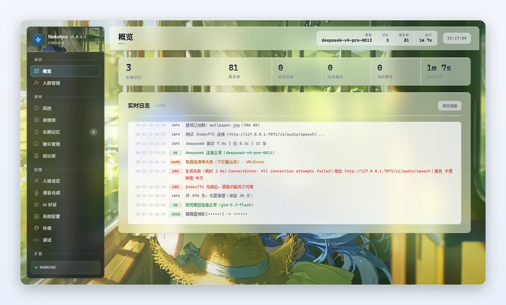
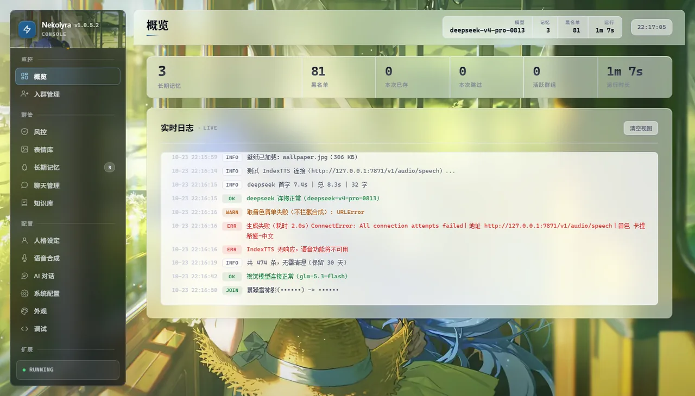
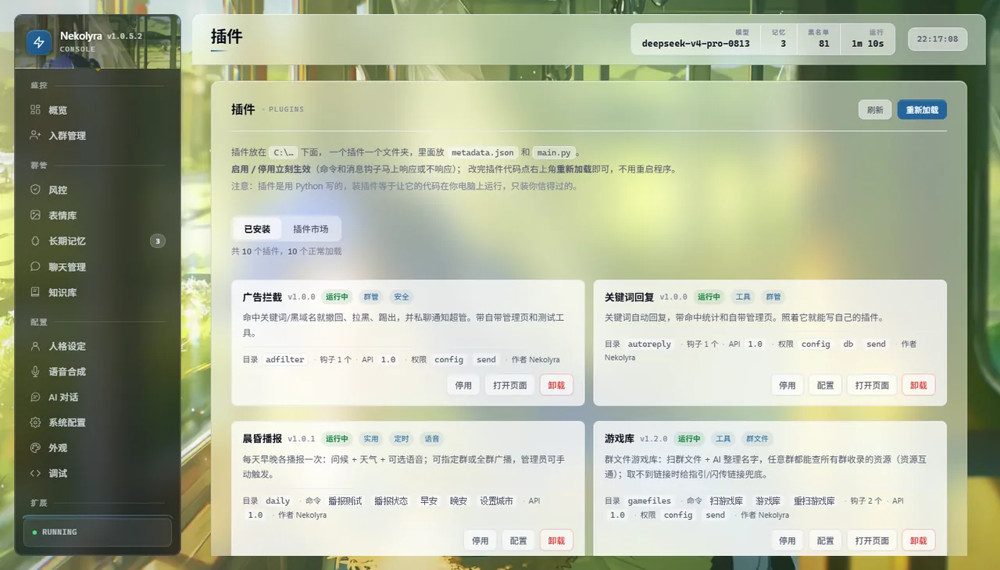
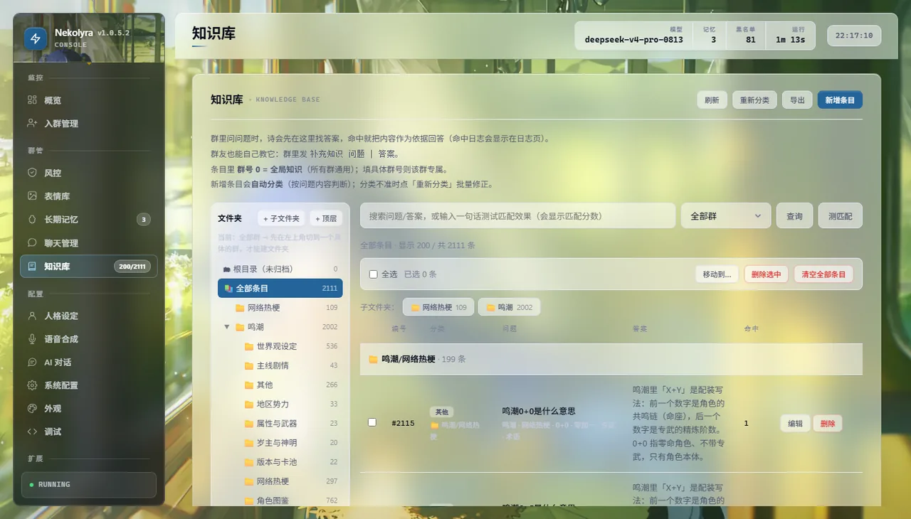
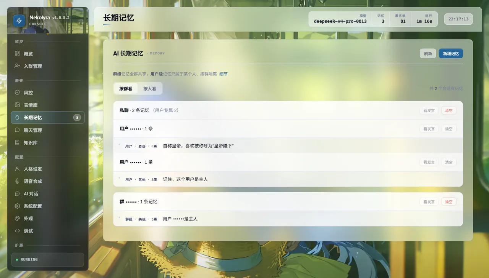
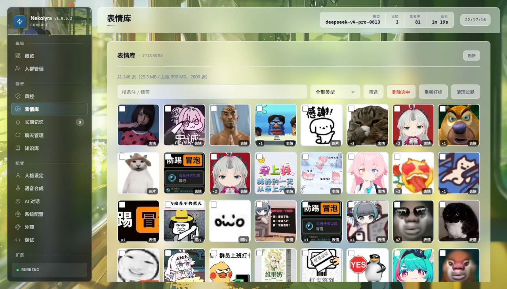
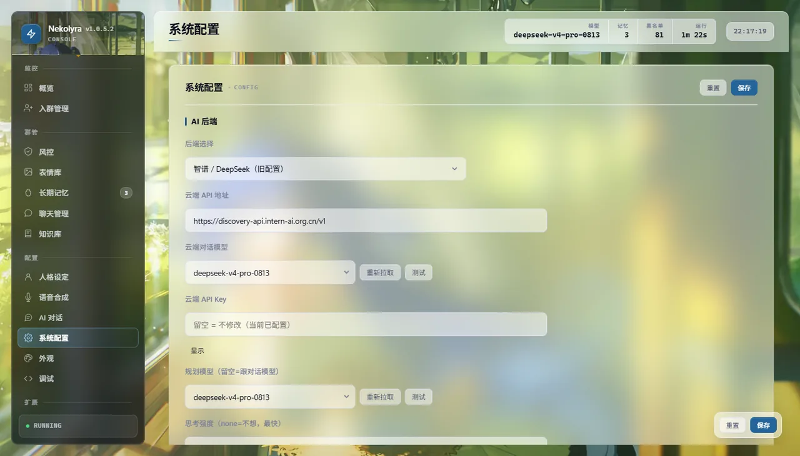

# Nekolyra

带 AI 人格的 QQ 群机器人。装在自己机器上，双击就能跑，数据全在本地。

[](docs/screenshots/01-概览.webp)


[](LICENSE)

[](VERSION)

做这个不是为了"再写一个能接 API 的机器人"。我只想要一个在群里说话不像客服的东西 ——
所以花时间最多的是提示词、人格和它的记忆，而不是插件数量。现在它有 12 个自带插件，
但那不是重点；重点是你在群里问它一句「你是谁」，它不会给你背简历。

Windows 下载 zip 解压双击就行。Linux 用 pip，Docker 有 compose 文件（我没测过，见下）。

[介绍页](https://awnpw.github.io/Nekolyra/) · [更新日志](CHANGELOG.md) · [常见问题](docs/常见问题.md)

---

## 三分钟跑起来

```bash
# Windows
# 下载 Nekolyra-desktop-v*.zip → 解压到空目录 → 双击 Nekolyra.exe

# Linux
git clone https://github.com/awnpw/Nekolyra.git && cd Nekolyra
pip install -r requirements.txt && python bot.py

# Docker（我没测过 —— 机器上没装 Docker，写的时候是照文档来的）
docker compose up -d
```

**跑起来是三件事，不是一件。** 装好只是第一步，还要配两样：

**一、QQ 协议端。** 机器人自己连不上 QQ，必须有它。NapCat / Lagrange.OneBot / LLOneBot 三选一，实现 OneBot v11，反向 WebSocket 连过来。

这里有个坑：**NapCat 的版本必须和 QQ 的版本对得上**。对不上不会报错，只会静默失灵 —— 你会看到机器人进程活着、日志正常、群里一句话不回。我在这上面浪费过一下午。

**二、AI 接口。** 不填它就不说话，其他功能（群管、插件、验证）照常。

语音（TTS）是可选的，不配只是不发语音。

---

## 界面

管理台是单页应用，跑在 pywebview 的原生窗口里，跟 OneBot 共用同一个端口。下面都是截图。

| | |
|---|---|
| <br>**概览** · 指标 + 实时日志 | <br>**插件** · 已安装 / 市场 |
| <br>**知识库** · 分文件夹、按群隔离 | <br>**长期记忆** · 按群/按人，能手动改 |
| <br>**表情库** · 自动打标，按情绪挑 | <br>**系统配置** · 改完即时生效 |

还有人格设定、AI 对话调试、语音合成、外观（壁纸/毛玻璃/深浅色）、调试（备份还原）八个页面，懒得一张张放。

---

## 它做什么

**记得住人。** 三层记忆分开存：群记忆、用户记忆、群内某人的客观画像。互不污染 —— 你在 A 群说的话不会漏到 B 群。

**查得到东西。** 知识库支持文件夹层级，命中后自动把内容塞进提示词。也可以给个网址，它自己抓正文切片入库，不用手抄。

**会发表情。** 群里收图 → 视觉模型写描述 → 按情绪打标 → 说话时按语气挑一张。不是随机发。

**能管群。** 入群验证、广告拦截、黑名单、退群自动拉黑、入群申请审批。够用，不是全能 —— **没有禁言**。

**能装插件。** 纯 Python，一个文件夹两个文件。命令、消息钩子、自带管理页，改完热加载不用重启。

架构图在 [docs/screenshots/架构.svg](docs/screenshots/架构.svg)，七层怎么串起来的在 [DESIGN.md](DESIGN.md)。

---

## 插件就这么写

```python
# data/plugins/hello/main.py
def setup(ctx):
    @ctx.command("你好", "打个招呼")
    async def _hi(event, text):
        await ctx.reply(event, "你好呀")
        return True
```

放进 `data/plugins/` → 管理页点「重新加载」→ 生效。

`ctx` 上有哪些方法、加载器会拦什么（比如它拒绝 `sys.exit` 和裸 `while True`）、
三个我踩过的坑，都在 [docs/插件开发.md](docs/插件开发.md)。
现成的模板在 [`Nekolyra-plugins/template`](https://github.com/awnpw/Nekolyra-plugins/tree/main/template)。

---

## 部署细节

### QQ 协议端怎么选

| 协议端 | 适合谁 |
|---|---|
| **NapCat** | 主流选择。功能全，但版本必须和 QQ 严格对应 |
| **Lagrange.OneBot** | 不想装 QQ 客户端时用，纯协议实现 |
| **LLOneBot** | LiteloaderQQNT 插件形态，跟 QQ 一起跑 |

三个都走 OneBot v11 反向 WebSocket，路径 `/onebot/v11/ws`，端口跟管理台同一个（默认 `8080`）。
不需要开第二个端口 —— 这是我这套和别的机器人不一样的地方之一。

选型、装法、踩坑记录在 [docs/部署指南.md](docs/部署指南.md)。

### AI 接口

三种 `ai_backend`，区别只在协议细节：

- `deepseek` —— OpenAI 兼容。绝大多数中转和自建服务用这个
- `openai` —— 官方 OpenAI 格式
- `anthropic` —— Messages API 格式

换一家只改配置，不动代码。填了地址、Key、模型名就能用。

### 语音

依赖 IndexTTS / CosyVoice2 这类本地 TTS，默认指向 `127.0.0.1:7861`。

**说清楚**：语音效果完全取决于你 TTS 部署的质量。参考音频挑得不好听起来就很怪。
「按情绪换音色」是先判断情绪再挑参考音频，是调参，不是理解情绪。

---

## 配置项

`config.json` 是唯一真值，包含 API Key，注意别提交到仓库。管理页能改的只是白名单里那部分，其余手填。

改哪些要重启：`admin_token`、`port`、`ai_backend` 要重启；人格三段、插件开关、记忆参数都是即时生效。

全部键的说明、默认值、取值范围、改了要不要重启 → [docs/配置项.md](docs/配置项.md)。

---

## 什么能用，什么别指望

**天天在用的**：AI 对话、拆分回复、人格、用户画像注入、三层记忆、知识库（导入导出、文件夹）、插件系统、管理台 14 个页面、入群验证、退群拉黑、入群审批、自动备份、自动更新验签。

**别指望的**：

**语音** —— 取决于你的 IndexTTS 部署。参考音频挑不好，听起来就是怪。情绪控制是调参。

**识图** —— 默认关着，要自己配视觉模型，配好之前没效果。

**群管** —— 只覆盖常见场景，**没有禁言功能**，也没有复杂权限体系。

**Docker** —— 我没测过。机器上没装 Docker。

**游戏库的 AI 整理** —— 受 `gf_ai_max_calls` 限制，文件多的群要扫好几轮才整理完。

---

## 隐私：数据发到哪

全部存在你机器的 `data/` 下，SQLite。没有遥测，没有统计上报，没有云端账号。管理台默认只听 `127.0.0.1`。

**会往外发的请求，这是全部**：

| 什么时候 | 发到哪 |
|---|---|
| AI 对话 | 你配的 AI 接口 |
| 发语音 | 你配的 TTS（默认本机 `127.0.0.1:7861`） |
| 识图 / 表情自动备注 | 你配的视觉模型（开了才发） |
| 检查更新（30 分钟一次，可手动） | `api.github.com`，兜底 jsDelivr / raw.githubusercontent |
| 下载更新包（你点了才下） | GitHub 直连，或你选的加速节点 |
| 插件市场索引 | 同上三个域名，或你设的 `NEKOE_PLUGIN_MARKET` |
| `wife` 插件的默认配图 | `api.pearapi.ai`（**第三方**，可在插件配置里改掉） |

**发到 AI 服务的内容**：对话本身，加上判定相关的记忆片段和知识库条目，加上系统提示词和用户画像（客观统计）。别的群的数据不会发过去 —— 它不知道别的群存在。

**管理台**：`lan_access` 默认关。想局域网访问自己开，但**先把默认 token 换成强密码**，开了等于把后台给同网段所有人。

---

## 常见问题

**机器人不说话？** 看 `startup.log` 有没有「AI 连接正常」。没有就是 AI 接口没配好。

**协议端连不上？** 九成是 NapCat 和 QQ 版本对不上。这个不报错，只静默失灵。

**管理页打不开 / 401？** token 在 `config.json` 的 `admin_token`，URL 是 `?token=` 加 URL 编码后的值。

**它说错话 / 一直不说话？** 管理页「AI 对话」页可以直接发消息调试，看到的是模型实际收到什么。人格不对就先改人格三段。

全量 16 条在 [docs/常见问题.md](docs/常见问题.md)，每块功能的设计取舍在 [docs/功能详解.md](docs/功能详解.md)。

---

## 更新与版本号

自动更新走 GitHub Releases。检查 → 下载 → Ed25519 验签 → 替换，签名不对中止。

版本号四段：`主.次.功能组.修bug`

```
1.0.0.0 → 1.0.0.1   修 bug
1.0.0.0 → 1.0.1.0   加了一组功能
1.0.0.0 → 1.1.0.0   大改 / 不兼容
```

---

## 参与贡献

Issue 和 PR 都收，尤其是三种：

**新插件** —— 写好了提 PR 到 [Nekolyra-plugins](https://github.com/awnpw/Nekolyra-plugins)。

**文档修正** —— 上面 FAQ 没覆盖到的坑。

**Bug 报告** —— 附日志。程序记的东西挺全（trace id + 各阶段耗时），有日志基本能定位。

---

## 仓库里那个 NekolyraUpdater.exe 是什么

**构建输入，不是产物垃圾**。`build.py` 打包时把它拷进 `dist/Nekolyra/`，「立即覆盖更新」按钮执行的就是它
（`update_applier.py` → `--install --payload --wait-pid`）。
约 8 MB，删了就没法打出带自更新能力的版本。

---

## 许可

GPL-3.0。可以自由使用、修改、分发，但衍生作品必须同样开源。

---

## 免责

非官方作品，跟腾讯和任何公司都没关系。仓库里**不包含任何官方美术资源**，内置壁纸是程序自带的自绘角色。

使用产生的后果自己承担。请遵守 QQ 用户协议 —— 别拿来发广告、刷屏、骚扰。

如果你是权利人，觉得仓库里有侵犯你权益的东西，开 Issue 说明，立刻处理。
