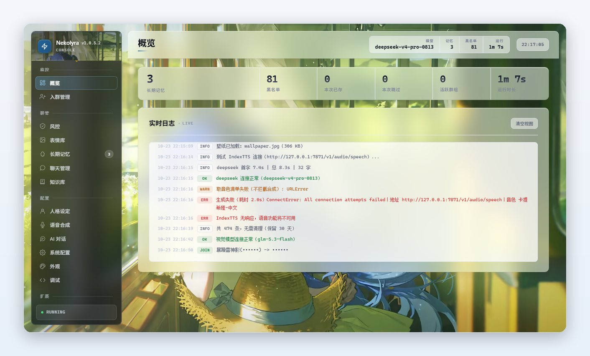
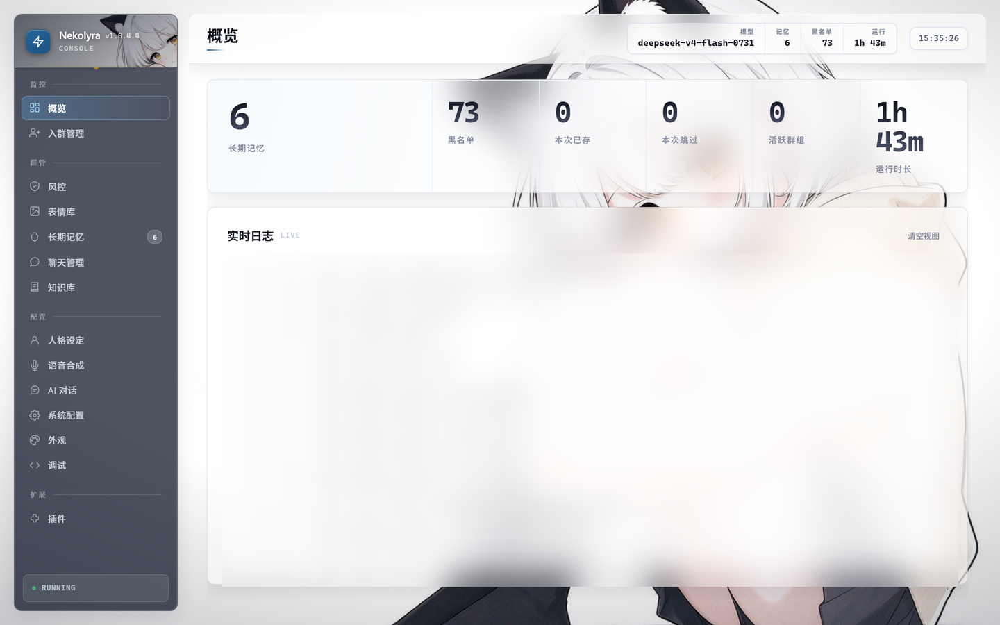
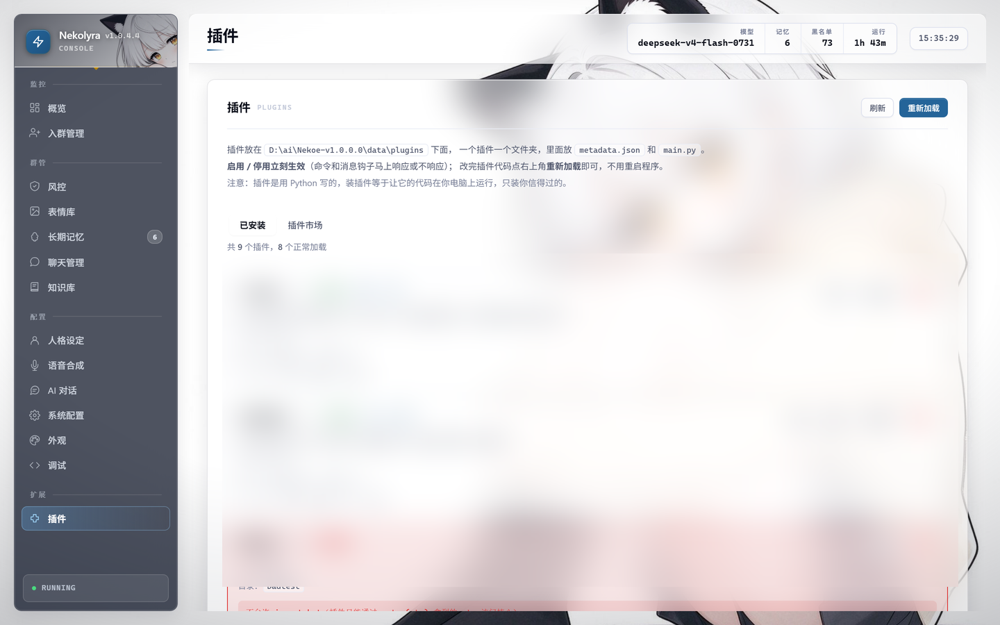
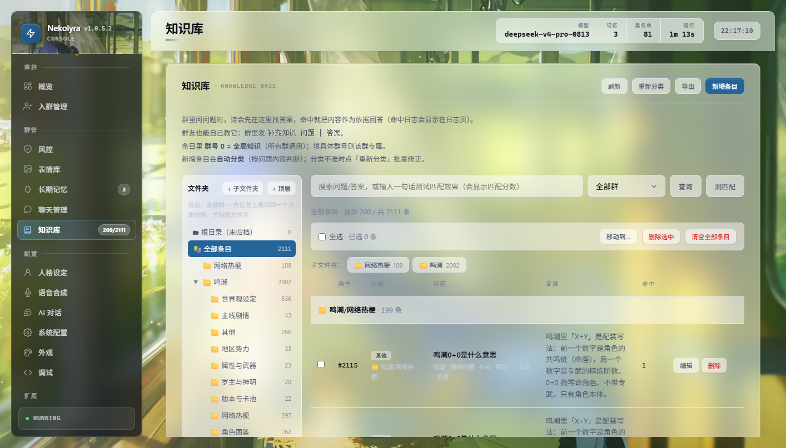
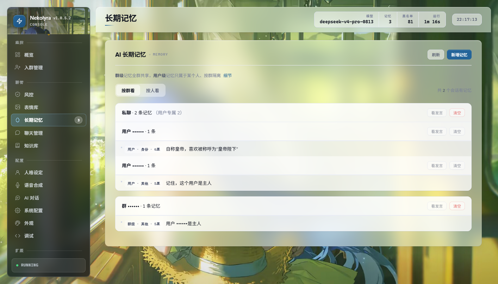
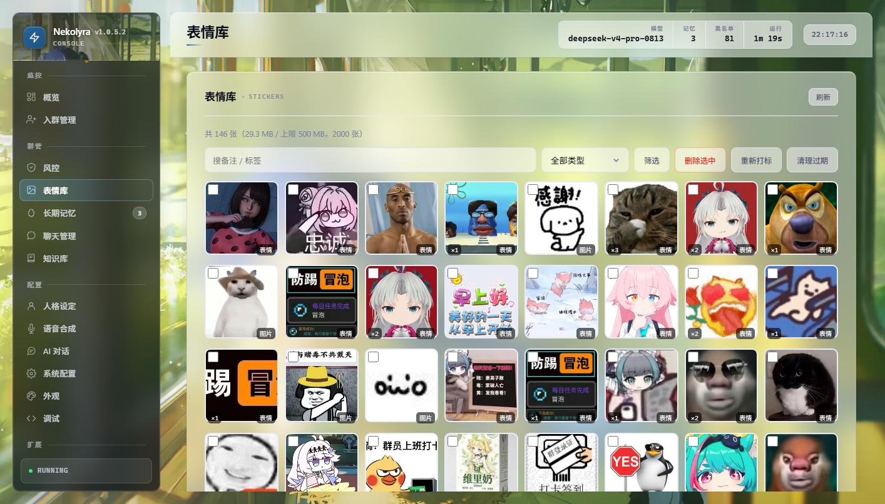
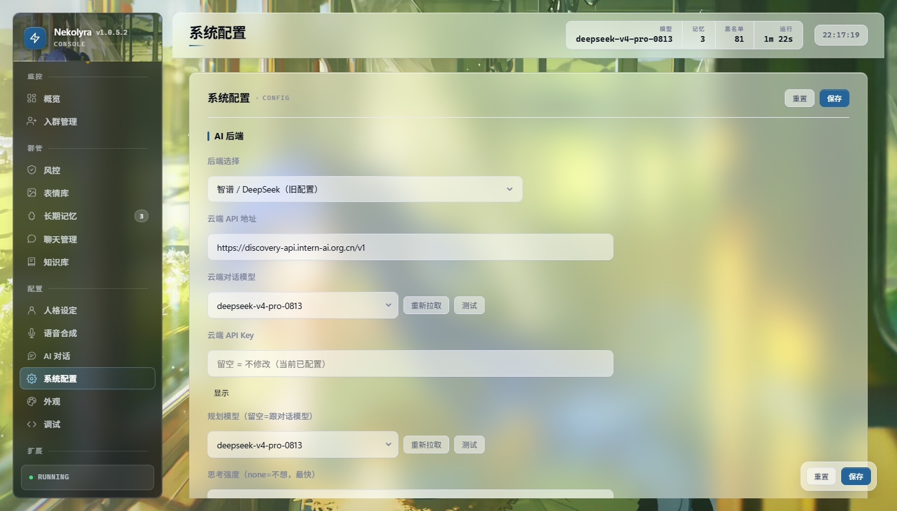
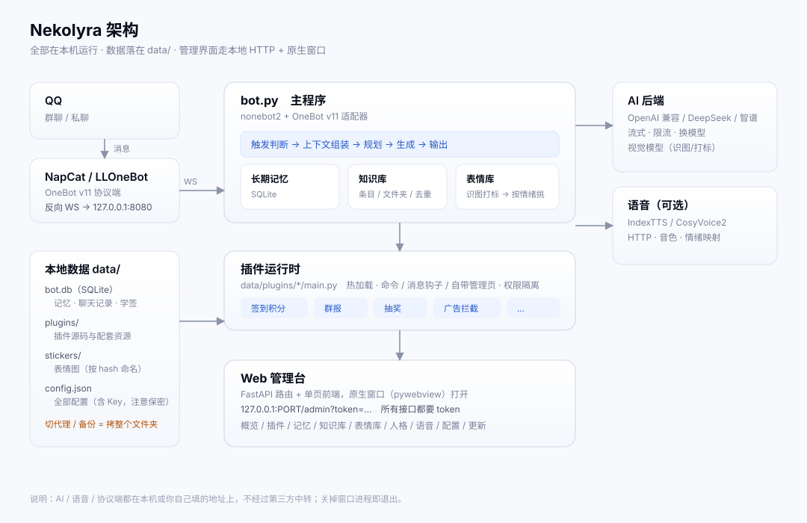

<div align="center">

# Nekolyra

**自己电脑上跑的 QQ 群 AI 机器人** —— 带数据库、长期记忆、知识库、插件运行时和一个完整的 Web 管理界面。

[](docs/screenshots/01-概览.png)

[](https://www.python.org/)
[](LICENSE)

[](VERSION)

[**简体中文**](README.md) · [English](README.en.md) · [更新日志](CHANGELOG.md) · [界面一览](#界面一览) · [常见问题](docs/常见问题.md)

<sub>装在哪、数据放哪、能干什么，往下三屏就能看完 —— 不想读长文就点 <a href="#三分钟快速开始">三分钟快速开始</a>。</sub>

</div>

---

## 三分钟快速开始

```bash
# Windows：下载 Nekolyra-desktop-v*.zip → 解压到空目录 → 双击 Nekolyra.exe
# Linux ：git clone https://github.com/awnpw/Nekolyra.git && cd Nekolyra && pip install -r requirements.txt && python bot.py
# Docker：docker compose up -d          （⚠ 未实测，见 docs/部署指南.md）
```

跑起来是三件事，不是一件：

| 步骤 | 做什么 | 大概花多久 |
|---|---|---|
| **1** | 装一种跑法（[Windows](docs/部署指南.md#windows) / [Linux](docs/部署指南.md#linux) / [Docker](docs/部署指南.md#docker)） | 1 分钟 |
| **2** | 配一个 **QQ 协议端** —— 机器人自己连不上 QQ，必须有它 | 3 分钟 |
| **3** | 填 **AI 接口** —— 不填它就不说话（别的功能照常） | 1 分钟 |

> **语音（TTS）是可选的**，不配也能用，只是不发语音。想开看[语音怎么配](docs/部署指南.md#语音怎么配)。

**最容易踩的坑在协议端**：NapCat 的版本和 QQ 的版本必须对得上，错了不会报错，
只会静默失灵。见 [QQ 协议端怎么选](docs/部署指南.md#qq-协议端怎么选)。

---

## 目录

| | | |
|---|---|---|
| [三分钟快速开始](#三分钟快速开始) | [AI 接口详细说明](docs/部署指南.md#ai-接口详细说明) | [配置项](docs/配置项.md) |
| [它是什么](#它是什么) | [语音详细说明](docs/部署指南.md#语音详细说明) | [目录结构](docs/部署指南.md#目录结构) |
| [**界面一览**](#界面一览) | [插件系统](docs/插件开发.md) | [常见问题](docs/常见问题.md) |
| [功能](#功能) · [功能详解](docs/功能详解.md) | [快速开始](docs/部署指南.md) | [项目状态（说实话）](#项目状态说实话) |
| [架构](#架构) | [参与贡献](#参与贡献) | [隐私](#隐私) / [许可](#许可) |

---

## 它是什么

一个跑在 QQ 群里的 AI 助手，装在你自己的机器上，数据全在本地 `data/` 里。

它比"接个 API 回话"的脚本多做了几件事：

| | |
|---|---|
| **有记性** | 分群记忆 + 分人记忆 + 客观画像，三层互不干扰 |
| **能查资料** | 带文件夹层级的知识库，命中后自动注入提示词 |
| **能管群** | 入群验证、广告拦截、黑名单、退群自动拉黑、入群申请审批 |
| **能装插件** | 自带 8 个插件；不想要就停用，想加就自己写 |
| **有管理界面** | 14 个内置页面，浏览器里点点就行，不用改配置文件 |
| **能自己更新** | 检查新版本 → 下载 → **Ed25519 验签** → 替换。签名不对直接中止 |

**它不做什么**：不做多租户、不做云托管、不搞账号体系、没有移动端 App
（管理界面是响应式网页，手机浏览器直接开）。

---

## 界面一览

管理界面是**原生窗口**（pywebview）里跑的单页应用，跟 OneBot 接口共用同一个端口。
下面全是真实截图，没有设计稿。

| | |
|---|---|
| <br>**概览** · 运行指标 + 实时日志 | <br>**插件** · 三列卡片，启用/停用/配置/卸载 |
| <br>**知识库** · 分文件夹、去重、按群隔离 | <br>**长期记忆** · 按群/按人看，能手动校对 |
| <br>**表情库** · 自动识图打标，按情绪挑图 | <br>**系统配置** · 地址、模型、Key，改完即时生效 |

<sub>还有：人格设定、AI 对话调试、语音合成、外观（壁纸/毛玻璃/深浅色）、调试（备份/还原）。</sub>

---

## 功能

一句话版：**会聊天、记得住、查得到、会发表情、能说话、能装插件、有管理台**。

| 模块 | 它做什么 |
|---|---|
| 🤖 AI 对话 | 人格 + 上下文 + 流式输出，被 @ / 叫名字 / 抽中概率才回 |
| 🧠 长期记忆 | SQLite 分层（群 / 人 / 群内某人），可手动校对 |
| 📚 知识库 | 分文件夹、去重、按群隔离 |
| 🎭 表情库 | 群里收图 → 视觉模型写描述 → 按情绪打标 → 按语气挑 |
| 🛡️ 群管与风控 | 入群验证、黑名单、广告拦截、踢人撤回 |
| 🔊 语音合成 | IndexTTS / CosyVoice2，可选；按情绪换音色 |
| 🔌 插件 | 纯 Python，命令 / 消息钩子 / 自带管理页，热加载 |
| 🖥️ 管理台 | 单页应用 + 原生窗口，概览到配置全在里面 |

**每块的详细说明、设计取舍、实测数据** -> **[docs/功能详解.md](docs/功能详解.md)**

## 架构



<sub>（点开看大图；图是 SVG，改起来就是一坨文本）</sub>

数据怎么走：

1. **QQ 客户端** —— 你平时用的那个
2. **QQ 协议端** —— NapCat / Lagrange.OneBot / LLOneBot 三选一，实现 OneBot v11，
   把 QQ 消息变成标准事件。它是**主动连过来**的一方（反向 WebSocket）
3. **Nekolyra** —— nonebot2 事件循环 → 群管 → 插件运行时 → 消息路由 → 会话上下文 → AI
4. **四路并行** —— 长期记忆（SQLite，按 `scope` 分层）、知识库（分文件夹，关键词检索）、
   表情库/识图（视觉模型）、AI provider（OpenAI 兼容协议，换一家只改配置）
5. **语音合成** —— IndexTTS，可选；先判断情绪，再按情绪挑音色
6. **管理界面** —— FastAPI，跟 OneBot 接口**共用同一个端口**
7. **data/** —— 聊天记录、记忆、知识库、表情、备份，全是本地 SQLite

**关于端口**：管理界面和 OneBot 反向 WebSocket 都在 `PORT`（默认 `8080`）上，
不需要第二个端口。OneBot v11 的路径由 nonebot2 的适配器注册，是 `/onebot/v11/ws`。

> ⚠️ **协议端版本和 QQ 版本必须对得上**，这是最容易踩的坑。
> 详见[快速开始 → QQ 协议端怎么选](docs/部署指南.md#qq-协议端怎么选)。

---


## 快速开始

三种跑法**选一种**，然后都要再配 [QQ 协议端](docs/部署指南.md#qq-协议端怎么选) 和 [AI 接口](docs/部署指南.md#ai-接口怎么选)。

| 跑法 | 一句话 |
|---|---|
| **Windows** | 下载 `Nekolyra-desktop-v*.zip` -> 解压到空目录 -> 双击 `Nekolyra.exe` |
| **Linux** | `git clone ... && pip install -r requirements.txt && python bot.py` |
| **Docker** | `docker compose up -d`（作者未实测，见文档说明） |

完整步骤（含 NapCat / Lagrange / LLOneBot 怎么选、AI 后端三种 `ai_backend` 的区别、
语音怎么配、怎么自己打 exe）全在 **[docs/部署指南.md](docs/部署指南.md)**。

## 配置项

`config.json` 是唯一真值（含 API Key，注意保密）。管理页能改的只是白名单里那部分，其余手填。

**全部键的说明、默认值、取值范围、改了要不要重启** -> **[docs/配置项.md](docs/配置项.md)**

## 插件系统

插件就是一个文件夹、两个文件：

```python
# data/plugins/hello/main.py
def setup(ctx):
    @ctx.command("你好", "打个招呼")
    async def _hi(event, text):
        await ctx.reply(event, "你好呀")
        return True
```

管理页可以启用 / 停用 / 配置 / 卸载，改完点「重新加载」生效，不用重启。

**`ctx` 上有什么、三个必踩的坑、加载器会拦什么** -> **[docs/插件开发.md](docs/插件开发.md)**

## 项目状态

**稳定、天天在用的**：

- AI 对话、拆分回复、人格、用户画像注入
- 长期记忆（群/用户/画像三层）、知识库（含导入导出、文件夹）
- 插件系统 + 8 个自带插件 + 插件市场
- 管理界面 14 个页面（深色模式、响应式、壁纸）
- 入群验证、退群拉黑、入群申请审批、自动备份
- 自动更新 + Ed25519 验签

**不太成熟、或者说清楚边界**：

- **语音** —— 依赖 IndexTTS 的部署质量；参考音频不好听起来就很怪。
  情绪控制是调参，不是"理解情绪"
- **识图** —— 默认关闭，需要自己配视觉模型；只在配好之后才有效果
- **群管** —— 只覆盖常见场景。**没有禁言功能**，也没有复杂的权限体系
- **游戏库的 AI 整理** —— 受 `gf_ai_max_calls` 限制，文件特别多的群要扫好几轮才整理完
- **Docker** —— `Dockerfile` 和 `docker-compose.yml` **作者没实测过**（机器上没装 Docker）

**版本号是四段**：`主.次.功能组.修bug`

| 变化 | 动哪一位 | 例子 |
|---|---|---|
| 修 bug / 小改动 | 最后一位 | `1.0.0.0` → `1.0.0.1` |
| 加了一组新功能 | 第三位 | `1.0.0.0` → `1.0.1.0` |
| 大改 / 不兼容 | 第二位 | `1.0.0.0` → `1.1.0.0` |

---

## 常见问题

高频的先看这里，全量约 30 条在 **[docs/常见问题.md](docs/常见问题.md)**。

- **机器人不说话？** 先看 `startup.log` 有没有「AI 连接正常」，没有就是 AI 接口没配好。
- **协议端连不上？** NapCat 版本必须和 QQ 版本对得上，错了不报错、只静默失灵。
- **管理页打不开 / 401？** token 在 `config.json` 的 `admin_token`，URL 要 `?token=` 编码后的值。

## 隐私

**数据不出你的机器**：

- 对话、记忆、知识库、积分、聊天记录、表情全在本地 `data/` 下的 SQLite
- 没有遥测、没有统计上报、没有云端账号
- 管理界面默认只听 `127.0.0.1`

**会往外发的请求**（这是全部）：

| 什么时候 | 发到哪 |
|---|---|
| AI 对话 | 你配的 AI 接口 |
| 发语音 | 你配的 TTS 服务（默认本机 `127.0.0.1:7861`） |
| 识图 / 表情自动备注（开了才发） | 你配的视觉模型接口 |
| 检查更新（30 分钟一次，可手动触发） | `api.github.com`；兜底 `cdn.jsdelivr.net`、`raw.githubusercontent.com` |
| 下载更新包（你点了才下） | GitHub 直连，或你选的加速节点 `ghproxy.net` / `gh-proxy.com` |
| 插件市场索引 | 同上三个域名 |
| **`wife` 插件的默认配图接口** | `https://api.pearapi.ai/api/today_wife`（**第三方服务**，可在插件配置里改掉） |

**发到 AI 服务的内容**：只有对话本身，加上被判定相关的记忆片段和知识库条目，
以及系统提示词和用户画像（客观统计）。**别的群的数据不会发过去**（分群隔离）。

**管理界面**：`lan_access` 默认关着。想局域网访问就自己开，
但**务必先把默认 token 换成强密码** —— 开了等于把整个后台暴露给同网段的人。

---

## 参与贡献

**Issue / PR 都欢迎**，尤其是：

- **新的插件** —— 写好了可以提 PR 到 [`Nekolyra-plugins`](https://github.com/awnpw/Nekolyra-plugins)
- **文档修正** —— 上面「常见问题」里没覆盖到的坑
- **Bug 报告** —— **附日志**。程序记的东西挺全的（trace id + 阶段耗时），有日志基本能定位

**提 PR 之前跑一下**：

```bash
# （自检脚本属于本地开发工具，不随仓库发布）
```

---

## 仓库里那个 `dist_launcher/NekolyraUpdater.exe` 是什么

它是**构建输入**，不是产物垃圾：`build.py` 打包时把它拷进 `dist/Nekolyra/`，
「立即覆盖更新」按钮执行的就是它（`update_applier.py` → `--install --payload --wait-pid`）。
约 8 MB，删了就没法打包出带自更新能力的版本。

## 许可

**GPL-3.0** —— 可以自由使用、修改、分发，但**衍生作品必须同样开源**。
完整文本见 [LICENSE](LICENSE)。

---

## 免责声明

- 这是**非官方作品**，与腾讯、任何游戏公司均无关联
- **仓库里不包含任何官方美术资源**。内置的默认壁纸是程序自带的原创角色插画
- 使用本程序产生的任何后果由使用者自行承担
- 请遵守 QQ 的用户协议，**不要用来发广告、刷屏、骚扰他人**

**如果你是权利人，认为仓库里有侵犯你权益的内容，开个 Issue 说明，会立刻处理。**

---

<div align="center">
<sub>

**Nekolyra** · GPL-3.0 · [更新日志](CHANGELOG.md) · [设计文档](DESIGN.md) · [下载](https://github.com/awnpw/Nekolyra/releases/latest)

</sub>
</div>
