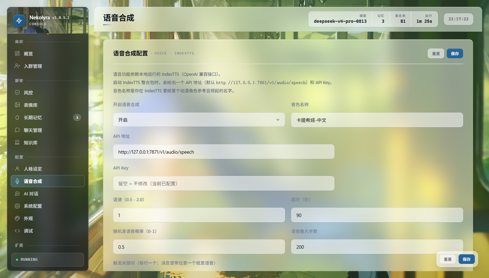

# 功能详解

> 本文是 [Nekolyra README](../README.md) 的功能章节，原样搬出来，首页只留一张表。

## 功能

### 🤖 AI 对话

- 只要求对方兼容 **OpenAI 协议**（`POST /v1/chat/completions`）。DeepSeek、智谱、
  通义、Kimi、硅基流动、OpenRouter、one-api 网关、vLLM、LM Studio、Ollama 兼容层
  都是同一套配置
- **流式输出**，并记录首字延迟与总耗时
- **人格可写** —— 分「名字 / 身份 / 行为 / 说话风格」四段，支持全局 + 按群/按私聊覆盖
- **用户画像注入** —— 发言次数、活跃天数、积分这些**客观统计**会喂给模型，
  「我是谁」「我常来吗」才答得上
- **拆分回复** —— 长回复按长度和标点拆成多条发（`split_max_parts` 默认 3 段）
- **思考强度可调** —— `reasoning_effort`；推理模型返回的思维链会记进日志的
  「AI思维链」频道（截前 200 字），**不在群里展示**
- 私聊也支持，可用 `enable_private_chat` 关掉

### 🧠 长期记忆

三层，存在同一张 `memory` 表里，靠 `scope` 区分：

| 层 | 是什么 | 谁写的 |
|---|---|---|
| **群记忆** | 这个群发生过什么、定了什么规矩 | 后台异步分析 |
| **用户记忆** | 这个人说过什么、什么脾气，按 `(群, 用户)` 隔离 | 后台异步分析 |
| **用户画像** | 发言次数、活跃天数、积分、签到连续天数 | **直接查库**，不是模型总结的，不会瞎编 |

每 `memory_check_every` 轮（默认 4）触发一次分析，按重要度（`memory_min_importance`，默认 3）
和相关性注入。私聊时群号固定为 `0`，跟群记忆天然隔开。

### 📚 知识库

- **两级文件夹**（`kb` + `kb_folders` 两张表），比如 游戏 → 角色图鉴 / 主线剧情 / 卡池
- **批量导入**，支持 `问题|答案` 每行一条的纯文本，也支持 JSON；导出同理
- **自动分类**，导入时按关键词猜分类，还能事后「重新分类」
- **命中计数**，检索按分数排序并累加命中数（`kb_match_threshold` 默认 0.5）
- **按群隔离**，每群最多 `kb_max_per_group` 条（默认 500，防刷）
- **不写库的试跑** —— `POST /api/chat` 带 `dry_run`，回复是真的，但一个字节都不写
  （不动记忆、不写聊天记录、连命中计数都不加）。管理页的「AI 对话」页默认用它

### 🎭 表情库与识图

- 群里收到的图片/表情自动入库，**按内容 MD5 命名** —— 同一张图发一百次只占一份
- 可选让**视觉模型自动写备注**（`sticker_auto_note`），机器人能在合适的时候发出去
- 有数量（2000）、单张大小（2 MB）、总量（500 MB）、闲置天数（90 天）四道闸
- **识图**（`vision_enabled`，**默认关闭**）：先用视觉模型把图描述成文字，再进提示词

### 🛡️ 群管与风控

- **入群验证** —— 新人进群出一道算术题，`verify_timeout` 秒（默认 60）没答对就踢。
  另有 `min_qq_level`（默认 25）卡 QQ 等级
- **退群/被移出自动拉黑**（`bl_add`），申请入群时直接拒
- **黑名单按「群 + 人」记录**，管理页能看到全部条目；没有单独的"全局黑名单"
- **入群申请审批** —— 管理页「入群管理」里通过/拒绝，可写拒绝理由
- **超管命令** —— 踢、拉黑
- **广告拦截是插件**（`adfilter`），不是内置功能：硬关键词 + 软关键词 + 黑域名 + 白名单，
  命中后撤回 + 拉黑 + 踢出，并私聊通知超管

### 🔊 语音合成

- 接 **IndexTTS**（本地部署），走 OpenAI 兼容的 `POST /v1/audio/speech`
- **触发方式**：命中 `voice_trigger_keywords`（默认「语音/说话/念出来/读出来/讲给我听/voice」），
  或者按 `voice_random_chance` 概率随机发
- **情绪控制**：`vector` 模式走 8 维情感向量
  （喜、怒、哀、惧、厌恶、低落、惊喜、平静），比 `speaker` 模式断句自然
- **音频后处理**：`off / voice_clarity / clear_narration / deharsh / warm / normalize`，
  默认 `deharsh`
- **自动降级**：TTS 连不上就只发文字，不会卡住对话
- 音色名从服务端拉（`/v1/audio/voices`），不是写死的

### 🔌 插件

主程序**不内置**游戏类、娱乐类功能，全在插件里。仓库自带 8 个：

| 插件 | 显示名 | 做什么 | 注册了什么 |
|---|---|---|---|
| `gamefiles` | 游戏库 | 扫群文件建索引、用 AI 整理名称，群员问就回文件 + 链接 | 3 命令 · 2 钩子 · 5 接口 · 1 页 |
| `adfilter` | 广告拦截 | 关键词/黑域名命中就撤回、拉黑、踢出，私聊通知超管 | 1 钩子 · 3 接口 · 1 页 |
| `autoreply` | 关键词回复 | 关键词自动回复，带命中统计 | 1 钩子 · 3 接口 · 1 页 |
| `sign` | 签到积分 | 每日签到、积分、排行榜 | 7 命令 · 5 接口 · 1 页 |
| `lottery` | 抽奖 | 从最近活跃的群成员里随机抽一个 | 1 命令 · 1 接口 · 1 页 |
| `report` | 群报 | 统计群里某天的发言排行 | 3 命令 · 1 接口 · 1 页 |
| `wife` | 今日老婆 | 每天抽一个，带 AI 写的介绍和配图，可用积分换 | 2 命令 · 2 接口 · 1 页 |
| `hello` | 打招呼 | 最小示例，照着它学写插件最快 | 2 命令 |

**游戏库（`gamefiles`）单独说一下**，因为它是这套插件系统能做什么的最好例子：

- 扫指定文件夹（`gf_scan_folders`）下的群文件，建一份每群独立的索引
- `gf_ai_enabled` 时用 AI 把乱名字整理成游戏名 + 别名
  （`塞尔达传说 王国之泪 v1.2 汉化硬盘版.rar` → `塞尔达传说：王国之泪`），
  每轮扫描最多调 `gf_ai_max_calls`（默认 6）次、每次 `gf_ai_batch`（默认 30）条
- 群员**不用命令**，直接说「有没有 塞尔达」就回文件名 + 大小 + 下载链接
  （`gf_reply_limit` 默认回 5 条；`gf_send_mode` 可以改成直接发文件本体）
- 群里出现的**「QQ文件闪传」链接也会自动收**（`gf_collect_shares`）。
  这些链接**不在群文件列表里**，`get_group_root_files` 看不到，只能从消息里抓
- **每小时自动扫一次**（`gf_auto_scan_hours` 默认 1，下限 10 分钟），启动后先等 120 秒
- **带自己的管理页**（「游戏库」），可以看、筛、手动重扫、探测、遗忘

### 🖥️ 管理界面

单文件内嵌的 Web 界面（FastAPI + 原生 JS，**没有前端构建步骤**），
地址 `http://127.0.0.1:8080/admin?token=xxx`。

**14 个内置页面**，侧栏分四组：

| 分组 | 页面 |
|---|---|
| 监控 | 概览 · 入群管理 |
| 群管 | 风控 · 表情库 · 长期记忆 · 聊天管理 · 知识库 |
| 配置 | 人格设定 · 语音合成 · AI 对话 · 系统配置 · 外观 · 调试 |
| 扩展 | 插件（插件注册的页面也挂在这里，装齐自带插件再 +7 个） |

支持深色模式、响应式（手机能用）、壁纸自定义（内置预设 + 上传自己的图 + 压暗/模糊调节）。

### 其它

- **零配置启动** —— 第一次运行自动生成 `config.json`，并生成管理员 token 打印在控制台
- **配置热重载** —— 管理页改完立即生效，不用重启
- **单文件 SQLite** —— 没有外部数据库依赖
- **自动备份** —— 默认每天 3 点备份数据库到 `data/backup/`，留 7 天
- **定时清理** —— 聊天记录、表情、语音临时文件都有保留天数
- **日志双写** —— 控制台 + `startup.log`，带 trace id 和阶段耗时

---
